# PBS ION demo: results

Generated by `report/make_report.py` from `./` on 2026-10-07 08:04:33 UTC. Measured values and criterion results are computed from the logs in `./`; scenario titles, descriptions, notes and conformance mappings are copied from `scenarios/*.json`. The demo exercises the PBS-CONFORMANCE-01 and PBS-CONFORMANCE-02 items listed per scenario; it makes no conformance claim and no certification claim.

## Summary

| Scenario | Title | Result | Criteria | Received/sent envelopes | Median latency (s) | Max latency (s) | Clean ION stop |
|---|---|---|---|---|---|---|---|
| S1 | Nominal traffic: rover telemetry at five priorities; signed commands, signed telemetry and a heartbeat from Earth; PING replies | PASS | 13/13 | 46/46 | 1.582 | 1.662 | yes |
| S2 | Scheduled outages in the contact plan: storage at rover, relay and Earth | PASS | 15/15 | 127/127 | 1.830 | 29.396 | yes |
| S3 | Unscheduled blackouts and random loss: LTP recovery | PASS | 9/9 | 119/119 | 1.581 | 27.484 | yes |
| S4 | Priority under a rate-limited link | PASS | 12/12 | 64/64 | 11.514 | 31.856 | yes |
| S5 | Expiry: bundle lifetime during an outage, and receivers rejecting expired envelopes | PASS | 20/20 | 20/33 | 1.610 | 30.140 | yes |
| S6 | Authenticated commands: tamper, replay, wrong key, expiry, authorization | PASS | 8/8 | 33/33 | 1.578 | 13.586 | yes |
| S7 | Cross-implementation: each endpoint parses the other's envelopes; identical inputs give identical bytes | PASS | 9/9 | 15/15 | 1.584 | 1.688 | yes |

Received/sent counts every envelope handed to ION, including those the scenario expects to be lost (S5) or rejected (S5, S6).

## Test environment

| Item | Value |
|---|---|
| Demo repository commit | 25ffe97aa464007464b889685b500191c2e49f7e (no tracked file modified outside results/, runs/ and REPORT.md) |
| ION | nasa-jpl/ION-DTN tag ion-open-source-4.2.0, commit 568df887cb9f18aa8ec013b1a566d83215e499ae; version string ION-OPEN-SOURCE-4.2.0; built by ion/build_ion.sh with NULL crypto suites (no BPSec) |
| Endpoint A (rover) | endpoint-python 0.1.0, PBS_LINK 0.1.4, Python 3.13.16; ION access through ctypes to libbp |
| Endpoint B (Earth) | endpoint-c 0.1.0, C, linked against ION libbp and OpenSSL libcrypto |
| Link emulator | emulator/linkemu.py (user-space UDP proxy, one socket per link direction, per-datagram log) |
| Host | Linux-6.18.44-fc-v77-x86_64-with-glibc2.39; 4 CPUs (Intel(R) Xeon(R) Processor @ 2.80GHz) |
| Clock | all three ION nodes, both endpoints and the emulator run on this host and read its CLOCK_REALTIME; kernel clock source tsc; NTP synchronized: not determined (timedatectl not available). No clock offset exists between the nodes; latency resolution is 1 us in the logs. |
| Cryptographic suites | PBS-SEC-B-01 demo suites 0xFF02 (Ed25519) and 0xFF01 (HMAC-SHA-256), TEST KEYS derived from public labels (docs/SPEC-DIGEST.md 6.3); not for operational use |
| Test vectors | docs/test-vectors.json, SHA-256 51e09856fa3c59130aa01f9c5d0e661a26cd19bda2aec74c45f8084bffd69b25 |

Self-checks run by `run_demo.sh` before the scenarios (logs in `./selfcheck/`):

| Check | Command | Result | Duration (s) | Last output line |
|---|---|---|---|---|
| emulator-tests | `build/venv-demo/bin/python emulator/test_linkemu.py` | pass | 0.8 | OK |
| scenario-tests | `build/venv-demo/bin/python scenarios/test_scenarios.py` | pass | 0.2 | OK |
| endpoint-b-tests | `make -s -C endpoint-c BUILD=build/endpoint-c test` | pass | 1.3 |   pbs_tool plan s6_auth.jsonl: 16 items |
| endpoint-a-tests | `endpoint-python/run_tests.sh` | pass | 2.3 | 318 passed, 1 skipped in 1.65s |

Topology (`ion/topology.json`): ROVER node ipn:99 (Endpoint A on ipn:99.1, Source ID Rover-Alpha), LUNAR GATEWAY relay node ipn:50 (store and forward only, no PBS processing), EARTH node ipn:23 (Endpoint B on ipn:23.1, Source ID Earth-MCC). BPv7 over LTP over UDP; every LTP datagram between nodes passes through the emulator. One-way delays: rover-gateway 0.25 s; gateway-earth 1.3 s. Priority to ION class of service, queue treatment and the no-expiry lifetime: docs/MAPPING-PROFILE.md.

## S1: Nominal traffic: rover telemetry at five priorities; signed commands, signed telemetry and a heartbeat from Earth; PING replies

Result: **PASS** (13 of 13 criteria passed).

All links up, fixed one-way delays only. Rover to Earth: telemetry at all five priorities, a 20000-byte BULK image chunk, a header-only envelope with ACK_REQ, and a Status envelope answering each PING; none of these is signed. Earth to rover: signed commands (Ed25519, and HMAC-SHA-256 for SET_HEATER), signed MCC telemetry (the rover requires a Security frame on every Earth-MCC envelope that has a payload, SPEC-DIGEST A38) and a header-only TTL 0 heartbeat. Signed envelopes travel only from Earth to the rover, so Endpoint B verifies no live signed envelope; it verifies SEC-B-01 only in the offline S7 vectors.

### Conditions

- Traffic phase: 40 s after the traffic origin; contact-plan reference time T0 = origin - 10 s (2026/10/07-07:22:35 UTC); traffic origin 2026-10-07 07:22:45 UTC.
- Drain after the traffic phase: ended at 40.000 s (0.000 s after the traffic phase), every envelope handed to ION had been received or its bundle lifetime had ended; endpoints stopped then.
- Endpoint A plan origin: +0.005 s from the traffic origin (bin/rover start-up 0.105 s); Endpoint B plan origin: the traffic origin (`--t0-us`).
- Legs: rover-gateway: one-way delay 0.25 s (emulator), contact-plan range 1 s, contact rate 125000 bytes/s; gateway-earth: one-way delay 1.3 s (emulator), contact-plan range 2 s, contact rate 125000 bytes/s.
- Emulator forwarding accuracy: 314 datagrams forwarded; send time minus scheduled time median 0.800 ms, p99 2.263 ms, max 2.737 ms.
- Emulator: delay only; no loss, no rate limit.
- No outage.
- Envelopes built (send records, including not sent): A->B: CRITICAL 6, HIGH 10, NORMAL 7, LOW 6, BULK 7; B->A: CRITICAL 1, HIGH 8, NORMAL 1.

### Criteria

| ID | Criterion | Measured | Result |
|---|---|---|---|
| S1-1 | Every rover envelope handed to ION is received at Earth | 36 of 36 delivered (ratio 1.000) | PASS |
| S1-2 | Every Earth envelope handed to ION is received at the rover | 10 of 10 delivered (ratio 1.000) | PASS |
| S1-3 | Every received envelope is byte-identical to the envelope handed to ION (SHA-256 of all bytes, 44 header bytes) | 46 of 46 received envelopes byte-identical (SHA-256 and header) | PASS |
| S1-4 | Every received envelope is accepted | 46 of 46: ACCEPT OK | PASS |
| S1-5 | The rover executes (logs) each authenticated command once, in order | executed: PING, SET_HEATER, DRIVE, CAPTURE_IMAGE, SET_MODE, PING, PING, PING | PASS |
| S1-6 | Each PING is answered and the answer reaches Earth | 4 of 4 delivered (ratio 1.000) | PASS |
| S1-7 | End-to-end latency between the 1.55 s propagation floor and 3.0 s | n=46 min 1.574 s median 1.582 s max 1.662 s | PASS |
| S1-8 | TTL 0 envelopes are sent with the 2147483647 s no-expiry bundle lifetime | 7 of 7 sent with lifetime 2147483647 s | PASS |
| S1-9 | TTL 0 envelopes sent with that lifetime are delivered | 7 of 7 delivered (ratio 1.000) | PASS |
| S1-10 | Every send uses the class of service of SPEC-DIGEST 7.5 for its priority | 46 of 46 sends used the 7.5 class of service | PASS |
| S1-11 | Every bundle source EID matches the Source ID mapping (Rover-Alpha ipn:99.1, Earth-MCC ipn:23.1) | 46 of 46 with the expected bundle source EID | PASS |
| S1-12 | No duplicate or unknown envelope is received | 46 recv records, 0 without a matching send record | PASS |
| S1-13 | No receiver accepts an envelope older than its TTL | 39 accepted envelopes with TTL > 0; 0 older than their TTL | PASS |

### Measurements

Delivery and latency per direction and priority (latency = receive time minus envelope Timestamp, both from the host clock; median = statistics.median; p95 = nearest rank, the value at position ceil(0.95 n) of the sorted latencies, which is the maximum when n < 20):

| Direction | Priority | Sent | Received | Delivery ratio | Min (s) | Median (s) | p95 (s) | Max (s) |
|---|---|---|---|---|---|---|---|---|
| A->B | CRITICAL | 6 | 6 | 1.000 | 1.579 | 1.585 | 1.594 | 1.594 |
| A->B | HIGH | 10 | 10 | 1.000 | 1.576 | 1.580 | 1.590 | 1.590 |
| A->B | NORMAL | 7 | 7 | 1.000 | 1.576 | 1.581 | 1.591 | 1.591 |
| A->B | LOW | 6 | 6 | 1.000 | 1.574 | 1.584 | 1.589 | 1.589 |
| A->B | BULK | 7 | 7 | 1.000 | 1.574 | 1.581 | 1.615 | 1.615 |
| B->A | CRITICAL | 1 | 1 | 1.000 | 1.579 | 1.579 | 1.579 | 1.579 |
| B->A | HIGH | 8 | 8 | 1.000 | 1.574 | 1.584 | 1.662 | 1.662 |
| B->A | NORMAL | 1 | 1 | 1.000 | 1.582 | 1.582 | 1.582 | 1.582 |

Repeated deliveries: none; no envelope handed to ION once was delivered more than once.

Emulated links (counters from `emulator-stats.json`; LTP segment types decoded from each datagram; a data retransmission is a data segment whose session, offset and length the emulator had already seen on that link):

| Link | Delay (s) | Loss | Rate (B/s) | Queue (B) | Blackouts | Datagrams in | out | Lost (random) | Lost (blackout) | Lost (queue full) | LTP data segments | LTP reports | LTP cancels | LTP data retransmissions | Max queue wait (s) |
|---|---|---|---|---|---|---|---|---|---|---|---|---|---|---|---|
| earth-gateway | 1.3 | 0.0 | none | none | none | 56 | 56 | 0 | 0 | 0 | 10 | 36 | 0 | 0 | 0.0 |
| gateway-earth | 1.3 | 0.0 | none | none | none | 101 | 101 | 0 | 0 | 0 | 55 | 10 | 0 | 0 | 0.0 |
| gateway-rover | 0.25 | 0.0 | none | none | none | 56 | 56 | 0 | 0 | 0 | 10 | 36 | 0 | 0 | 0.0 |
| rover-gateway | 0.25 | 0.0 | none | none | none | 101 | 101 | 0 | 0 | 0 | 55 | 10 | 0 | 0 | 0.0 |

ION bundle counters per node (last `bpstats` report in the node's ion.log, cumulative since node start: sourced, forwarded, transmitted, received, delivered, reforwarded, deleted at lifetime expiry):

| Node | src | fwd | xmt | rcv | dlv | rfw | exp |
|---|---|---|---|---|---|---|---|
| rover | 36 | 36 | 36 | 10 | 10 | 0 | 0 |
| gateway | 0 | 46 | 46 | 46 | 0 | 0 | 0 |
| earth | 10 | 10 | 10 | 36 | 36 | 0 | 0 |

ION LTP span counters per node and span (`ltpstats -a` after the traffic phase; export = blocks this node sent on the span, import = blocks it received; screened = segments discarded because they arrived while the contact plan gave the sender no transmission to this node; backlog = red segments discarded because the blocks waiting for delivery to BP had reached the `m maxbacklog` limit, counted by ION as in_seg_too_fast):

| Node to peer | Checkpoints sent | Checkpoints resent | Data segments resent | Export cancels | Exports complete | Imports complete | Reports resent | Redundant segments in | Screened segments in | Backlog-discarded segments in |
|---|---|---|---|---|---|---|---|---|---|---|
| rover to gateway | 36 | 0 | 0 | 0 | 36 | 10 | 0 | 0 | 0 | 0 |
| gateway to earth | 36 | 0 | 0 | 0 | 36 | 10 | 0 | 0 | 0 | 0 |
| gateway to rover | 10 | 0 | 0 | 0 | 10 | 36 | 0 | 0 | 0 | 0 |
| earth to gateway | 10 | 0 | 0 | 0 | 10 | 36 | 0 | 0 | 0 | 0 |

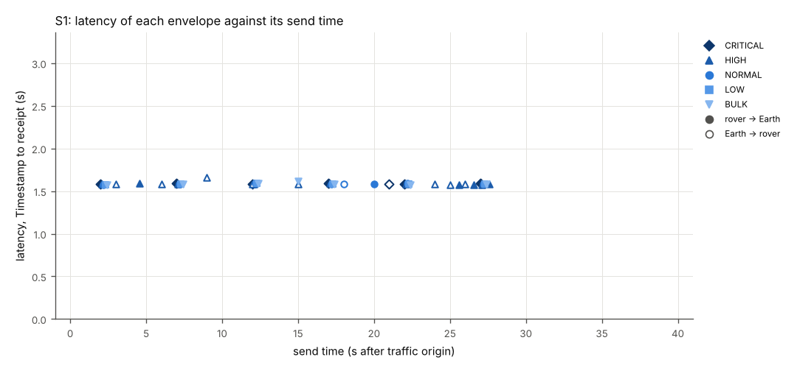

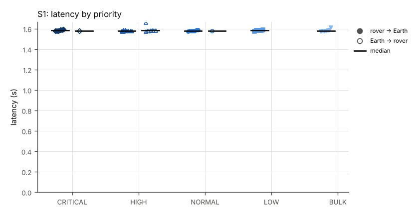

### PBS conformance items exercised

| Item | How |
|---|---|
| PBS-C02-T002 | S1-3: header bytes and SHA-256 equal after BPv7 carriage over LTP through the relay |
| PBS-C02-T010 | partial: S1-10 shows one ION class of service per priority (SPEC-DIGEST 7.5, docs/MAPPING-PROFILE.md); the demo has one static mapping, with no network state input and no policy version, so a mapping per defined network state is not exercised |
| PBS-C02-T015 | one recv record per delivered bundle and one exec record per executed command (S1-4, S1-5) |
| PBS-C02-T016 | S1-8, S1-9: TTL 0 envelopes carried with the no-expiry lifetime of the mapping profile (docs/MAPPING-PROFILE.md) and delivered |
| PBS-CONFORMANCE-01 4.1, 4.2, 4.3, 5.1 | both receivers parse and CRC-check every envelope of the other implementation (S1-4) |
| PBS-CONFORMANCE-01 6 | all five priorities sent and received (S1-1, S1-10) |
| PBS-CONFORMANCE-01 7 | Sequence starts at 1 and increments per envelope at each sender (send records) |
| PBS-DTN-MAP-01 5.1, 6.1, 6.1.1, 6.2, 7.2, 8 | one envelope per bundle payload, lifetime from TTL, verbatim extraction, Source ID to EID mapping (S1-3, S1-8, S1-11) |

Files: `./S1/` (scenario definition `scenario.json`, contact plan `contacts.ionrc`, emulator configuration `emulator.json`, endpoint plans `rover-plan.json` and `earth-plan.jsonl`, endpoint logs `endpoint-a.jsonl` and `endpoint-b.jsonl`, emulator log `emulator.jsonl`, node logs `ion/`, tables `envelopes.csv`, `receipts.csv`, `links.csv`, `ionstats.csv`, verdict `verdict.json`).

## S2: Scheduled outages in the contact plan: storage at rover, relay and Earth

Result: **PASS** (15 of 15 criteria passed).

Two planned outages that every node knows from the contact plan, each also enforced by the emulator: the rover-Gateway leg is down from 25 s to 50 s (rover out of view of the Gateway), and the Gateway-Earth leg is down from 65 s to 85 s (no Earth contact). The rover sends one telemetry envelope per second and answers PINGs; Mission Control sends a signed PING every 6 s. Envelopes are expected to wait in ION storage at the node in front of the closed leg and to be delivered after the contact resumes. After the traffic phase (105 s) the runner keeps both endpoints running until every envelope handed to ION has been received, for at most 30 s; S2-1 and S2-2 count receipts up to the end of that drain, and S2-19 reports the last receipt and its margin to 105 s.

### Conditions

- Traffic phase: 105 s after the traffic origin; contact-plan reference time T0 = origin - 10 s (2026/10/07-07:23:55 UTC); traffic origin 2026-10-07 07:24:05 UTC.
- Drain after the traffic phase: ended at 105.000 s (0.000 s after the traffic phase), every envelope handed to ION had been received or its bundle lifetime had ended; endpoints stopped then.
- Endpoint A plan origin: +0.005 s from the traffic origin (bin/rover start-up 0.105 s); Endpoint B plan origin: the traffic origin (`--t0-us`).
- Legs: rover-gateway: one-way delay 0.25 s (emulator), contact-plan range 1 s, contact rate 125000 bytes/s; gateway-earth: one-way delay 1.3 s (emulator), contact-plan range 2 s, contact rate 125000 bytes/s.
- Emulator forwarding accuracy: 898 datagrams forwarded; send time minus scheduled time median 0.796 ms, p99 2.260 ms, max 6.639 ms.
- Emulator: delay only; no loss, no rate limit.
- Outage 25 s to 50 s on rover-gateway (scheduled): rover out of view of the Gateway (planned).
- Outage 65 s to 85 s on gateway-earth (scheduled): no Gateway-Earth contact (planned).
- Envelopes built (send records, including not sent): A->B: CRITICAL 19, HIGH 35, NORMAL 19, LOW 19, BULK 19; B->A: HIGH 16.

### Criteria

| ID | Criterion | Measured | Result |
|---|---|---|---|
| S2-1 | Every rover envelope handed to ION is received at Earth (receipts up to the end of the drain) | 111 of 111 delivered (ratio 1.000) | PASS |
| S2-2 | Every Earth command handed to ION is received at the rover (receipts up to the end of the drain) | 16 of 16 delivered (ratio 1.000) | PASS |
| S2-3 | Every received envelope is byte-identical to the envelope handed to ION | 127 of 127 received envelopes byte-identical (SHA-256 and header) | PASS |
| S2-4 | Every received envelope is accepted (no TTL expired in storage) | 127 of 127: ACCEPT OK | PASS |
| S2-5 | At 45 s the rover node holds rover envelopes sent since the rover-Gateway outage began | rover node held 20 matching bundles at 45.000 s (all bundles: 21) | PASS |
| S2-6 | At 45.5 s the Gateway node holds Earth commands waiting for the rover contact | gateway node held 3 matching bundles at 45.500 s (all bundles: 3) | PASS |
| S2-7 | At 80 s the Gateway node holds rover envelopes sent since 63 s, waiting for the Earth contact | gateway node held 17 matching bundles at 80.000 s (all bundles: 17) | PASS |
| S2-8 | At 80.5 s the Earth node holds commands waiting for the Gateway contact | earth node held 2 matching bundles at 80.500 s (all bundles: 3) | PASS |
| S2-9 | Rover envelopes sent during the rover-Gateway outage arrive no earlier than its end (50 s) plus 1.55 s propagation | 24 received; earliest receipt at 53.145 s | PASS |
| S2-10 | Earth commands sent during the rover-Gateway outage arrive no earlier than its end plus 0.25 s | 4 received; earliest receipt at 51.524 s | PASS |
| S2-11 | Rover envelopes sent during the Gateway-Earth outage arrive no earlier than its end (85 s) plus 1.3 s | 19 received; earliest receipt at 92.693 s | PASS |
| S2-12 | Earth commands sent during the Gateway-Earth outage arrive no earlier than its end plus 1.55 s | 3 received; earliest receipt at 88.393 s | PASS |
| S2-13 | No duplicate or unknown envelope is received | 127 recv records, 0 without a matching send record | PASS |
| S2-14 | No receiver accepts an envelope older than its TTL | 108 accepted envelopes with TTL > 0; 0 older than their TTL | PASS |
| S2-15 | No node transmits into a scheduled outage (emulator blackout drops = 0) | drop_blackout total 0 (rover-gateway=0, gateway-rover=0, gateway-earth=0, earth-gateway=0) | PASS |
| S2-16 | LTP segments from the Gateway discarded by Earth's LTP screening (informative) | earth node, span to gateway: in_seg_screened = 34 (ltpstats -a) | info |
| S2-17 | LTP segments from the rover discarded by the Gateway's LTP screening (informative) | gateway node, span to rover: in_seg_screened = 0 (ltpstats -a) | info |
| S2-18 | Checkpoints the Gateway resent to Earth (informative) | gateway node, span to earth: ckpt_re_xmit = 29 (ltpstats -a) | info |
| S2-19 | Last receipt and its margin to the end of the traffic phase (105 s); receipts during the drain (informative; no delivery deadline is a pass/fail criterion) | last receipt at 97.588 s; traffic phase ends at 105 s (margin 7.412 s); 0 receipts after it; drain ended at 105.0 s, every envelope handed to ION received or its lifetime ended | info |

### Measurements

Delivery and latency per direction and priority (latency = receive time minus envelope Timestamp, both from the host clock; median = statistics.median; p95 = nearest rank, the value at position ceil(0.95 n) of the sorted latencies, which is the maximum when n < 20):

| Direction | Priority | Sent | Received | Delivery ratio | Min (s) | Median (s) | p95 (s) | Max (s) |
|---|---|---|---|---|---|---|---|---|
| A->B | CRITICAL | 19 | 19 | 1.000 | 1.573 | 1.584 | 26.139 | 26.139 |
| A->B | HIGH | 35 | 35 | 1.000 | 1.570 | 1.585 | 25.154 | 28.140 |
| A->B | NORMAL | 19 | 19 | 1.000 | 1.575 | 4.413 | 28.724 | 28.724 |
| A->B | LOW | 19 | 19 | 1.000 | 1.571 | 7.741 | 28.427 | 28.427 |
| A->B | BULK | 19 | 19 | 1.000 | 1.575 | 7.509 | 29.396 | 29.396 |
| B->A | HIGH | 16 | 16 | 1.000 | 1.573 | 1.587 | 24.523 | 24.523 |

Envelopes sent during an outage. Time held = latency minus the 1.55 s one-way propagation of the path. Leg resumed = first datagram the emulator received on either direction of the leg after the outage ended, minus the end time. Delivered after = receive time minus the end of the outage:

| Outage | Direction | Sent | Received | Time held min (s) | median (s) | max (s) | Leg resumed after (s) | Delivered after, first (s) | last (s) |
|---|---|---|---|---|---|---|---|---|---|
| rover-gateway 25-50 s (scheduled) | A->B | 25 | 25 | 2.863 | 14.663 | 26.877 | 1.263 | 3.145 | 3.515 |
| rover-gateway 25-50 s (scheduled) | B->A | 4 | 4 | 5.045 | 14.004 | 22.973 | 1.263 | 1.524 | 1.595 |
| gateway-earth 65-85 s (scheduled) | A->B | 20 | 20 | 7.180 | 17.513 | 27.846 | 1.348 | 7.693 | 10.404 |
| gateway-earth 65-85 s (scheduled) | B->A | 3 | 3 | 5.866 | 11.860 | 17.843 | 1.348 | 3.393 | 3.416 |

LTP blocks whose first checkpoint segment the emulator forwarded in the 3 s after the leg resumed; a block counts as resent when the sender transmitted its checkpoint again before any report segment for it came back; report delay = first report minus first checkpoint (emulator receive times):

| Outage | Data direction | Leg resumed after (s) | Blocks | Checkpoint resent before a report | Report delay min (s) | median (s) | max (s) |
|---|---|---|---|---|---|---|---|
| rover-gateway 25-50 s (scheduled) | rover-gateway | 1.263 | 35 | 0 | 0.252 | 0.326 | 0.357 |
| rover-gateway 25-50 s (scheduled) | gateway-rover | 1.263 | 5 | 0 | 0.252 | 0.253 | 0.258 |
| gateway-earth 65-85 s (scheduled) | gateway-earth | 1.348 | 31 | 24 | 1.302 | 6.333 | 6.355 |
| gateway-earth 65-85 s (scheduled) | earth-gateway | 1.348 | 4 | 0 | 1.303 | 1.303 | 1.306 |

Bundles held in ION storage (`bplist` on the node during the run; each bundle's payload identified as a demo envelope by Sequence and Timestamp):

| Probe | Node | At (s) | Bundles | Envelopes by label |
|---|---|---|---|---|
| rover during rover-Gateway outage | rover | 45.0 | 21 | S2-BULK x4; S2-CRITICAL x4; S2-HIGH x4; S2-LOW x4; S2-NORMAL x5 |
| Gateway during rover-Gateway outage | gateway | 45.5 | 3 | S2-PING x3 |
| Gateway during Gateway-Earth outage | gateway | 80.0 | 17 | PING-REPLY x1; S2-BULK x3; S2-CRITICAL x3; S2-HIGH x3; S2-LOW x3; S2-NORMAL x4 |
| Earth during Gateway-Earth outage | earth | 80.5 | 3 | S2-PING x3 |

Repeated deliveries: none; no envelope handed to ION once was delivered more than once.

Emulated links (counters from `emulator-stats.json`; LTP segment types decoded from each datagram; a data retransmission is a data segment whose session, offset and length the emulator had already seen on that link):

| Link | Delay (s) | Loss | Rate (B/s) | Queue (B) | Blackouts | Datagrams in | out | Lost (random) | Lost (blackout) | Lost (queue full) | LTP data segments | LTP reports | LTP cancels | LTP data retransmissions | Max queue wait (s) |
|---|---|---|---|---|---|---|---|---|---|---|---|---|---|---|---|
| earth-gateway | 1.3 | 0.0 | none | none | 65-85 scheduled | 151 | 151 | 0 | 0 | 0 | 17 | 118 | 0 | 1 | 0.0 |
| gateway-earth | 1.3 | 0.0 | none | none | 65-85 scheduled | 328 | 328 | 0 | 0 | 0 | 193 | 17 | 0 | 34 | 0.0 |
| gateway-rover | 0.25 | 0.0 | none | none | 25-50 scheduled | 143 | 143 | 0 | 0 | 0 | 16 | 111 | 0 | 0 | 0.0 |
| rover-gateway | 0.25 | 0.0 | none | none | 25-50 scheduled | 276 | 276 | 0 | 0 | 0 | 149 | 16 | 0 | 0 | 0.0 |

ION bundle counters per node (last `bpstats` report in the node's ion.log, cumulative since node start: sourced, forwarded, transmitted, received, delivered, reforwarded, deleted at lifetime expiry):

| Node | src | fwd | xmt | rcv | dlv | rfw | exp |
|---|---|---|---|---|---|---|---|
| rover | 111 | 111 | 111 | 16 | 16 | 0 | 0 |
| gateway | 0 | 127 | 127 | 127 | 0 | 0 | 0 |
| earth | 16 | 16 | 16 | 111 | 111 | 0 | 0 |

ION LTP span counters per node and span (`ltpstats -a` after the traffic phase; export = blocks this node sent on the span, import = blocks it received; screened = segments discarded because they arrived while the contact plan gave the sender no transmission to this node; backlog = red segments discarded because the blocks waiting for delivery to BP had reached the `m maxbacklog` limit, counted by ION as in_seg_too_fast):

| Node to peer | Checkpoints sent | Checkpoints resent | Data segments resent | Export cancels | Exports complete | Imports complete | Reports resent | Redundant segments in | Screened segments in | Backlog-discarded segments in |
|---|---|---|---|---|---|---|---|---|---|---|
| rover to gateway | 111 | 0 | 0 | 0 | 111 | 16 | 0 | 0 | 0 | 0 |
| gateway to earth | 116 | 29 | 15 | 0 | 111 | 16 | 1 | 1 | 0 | 0 |
| gateway to rover | 16 | 0 | 0 | 0 | 16 | 111 | 0 | 0 | 0 | 0 |
| earth to gateway | 16 | 1 | 0 | 0 | 16 | 111 | 2 | 5 | 34 | 0 |

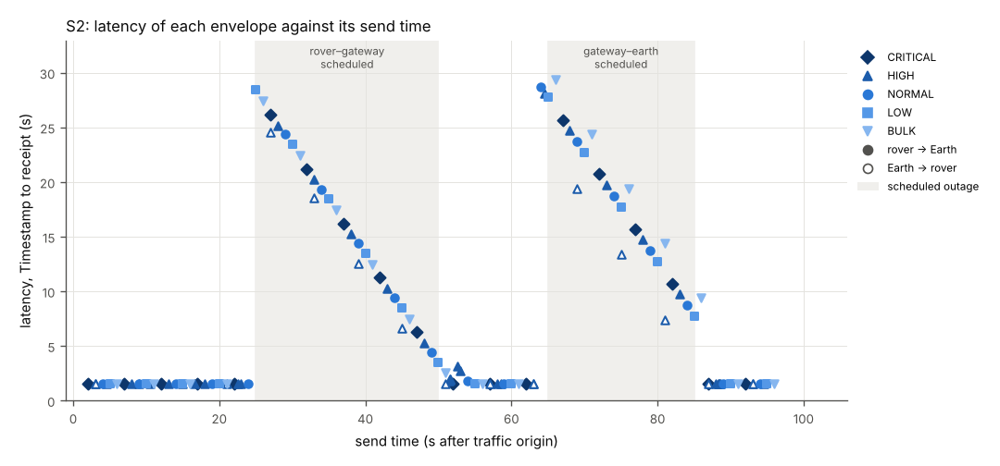

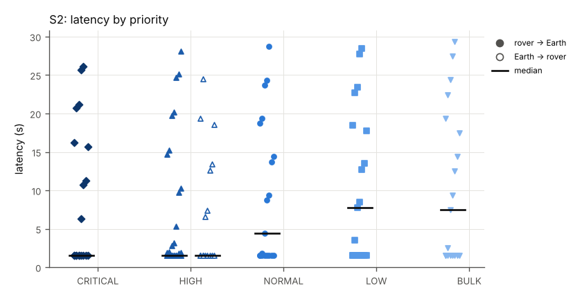

### PBS conformance items exercised

| Item | How |
|---|---|
| PBS-C02-T011 | store-and-forward delivery across complete scheduled outages (S2-1, S2-2, S2-5 to S2-12) |
| PBS-C02-T002 | S2-3: headers unchanged after storage in ION |
| PBS-CONFORMANCE-01 4.2 | receive processing of stored-then-delivered envelopes (S2-4) |
| PBS-DTN-MAP-01 9; PBS-DTN-MAP-02 10 (store-and-forward delivery) | envelopes stored as bundles at the rover, the relay and Earth (S2-5 to S2-8) |
| PBS-CONFORMANCE-02 Section 4 (complete outage, delayed contact, service restoration) | two scheduled outages on different legs |

Files: `./S2/` (scenario definition `scenario.json`, contact plan `contacts.ionrc`, emulator configuration `emulator.json`, endpoint plans `rover-plan.json` and `earth-plan.jsonl`, endpoint logs `endpoint-a.jsonl` and `endpoint-b.jsonl`, emulator log `emulator.jsonl`, node logs `ion/`, tables `envelopes.csv`, `receipts.csv`, `links.csv`, `ionstats.csv`, verdict `verdict.json`).

## S3: Unscheduled blackouts and random loss: LTP recovery

Result: **PASS** (9 of 9 criteria passed).

The contact plan says every link is up, but the emulator drops 5 % of datagrams at random on all four link directions and blacks out the Gateway-Earth leg from 40 s to 55 s and the rover-Gateway leg from 75 s to 80 s without telling ION. The rover sends one telemetry envelope per second (BULK envelopes have a 3000-byte payload; LTP sends each as four data segments, maximum segment size 1024 bytes) and answers PINGs; Mission Control sends a signed PING every 5 s. LTP retransmission is expected to deliver every envelope. When the Gateway cancels an LTP block that Earth had in fact received and BP forwards the bundle again, Earth receives that envelope twice; such a repeated delivery is counted and listed, and passes only when it is the same bundle as the first delivery and ION re-forwarded at least as many bundles.

### Conditions

- Traffic phase: 110 s after the traffic origin; contact-plan reference time T0 = origin - 10 s (2026/10/07-07:26:20 UTC); traffic origin 2026-10-07 07:26:30 UTC.
- Drain after the traffic phase: ended at 110.000 s (0.000 s after the traffic phase), every envelope handed to ION had been received or its bundle lifetime had ended; endpoints stopped then.
- Endpoint A plan origin: -0.004 s from the traffic origin (bin/rover start-up 0.096 s); Endpoint B plan origin: the traffic origin (`--t0-us`).
- Legs: rover-gateway: one-way delay 0.25 s (emulator), contact-plan range 1 s, contact rate 125000 bytes/s; gateway-earth: one-way delay 1.3 s (emulator), contact-plan range 2 s, contact rate 125000 bytes/s.
- Emulator forwarding accuracy: 948 datagrams forwarded; send time minus scheduled time median 0.823 ms, p99 2.300 ms, max 4.988 ms.
- Emulator settings beyond the delays: *: loss=0.05 (`*` = all four directions); loss seed 3.
- Outage 40 s to 55 s on gateway-earth (unscheduled): unannounced loss of the Gateway-Earth link.
- Outage 75 s to 80 s on rover-gateway (unscheduled): unannounced loss of the rover-Gateway link.
- Envelopes built (send records, including not sent): A->B: CRITICAL 17, HIGH 34, NORMAL 17, LOW 17, BULK 17; B->A: HIGH 17.

### Criteria

| ID | Criterion | Measured | Result |
|---|---|---|---|
| S3-1 | Every rover envelope handed to ION is received at Earth | 102 of 102 delivered (ratio 1.000) | PASS |
| S3-2 | Every Earth command handed to ION is received at the rover | 17 of 17 delivered (ratio 1.000) | PASS |
| S3-3 | Every received envelope is byte-identical to the envelope handed to ION | 119 of 119 received envelopes byte-identical (SHA-256 and header) | PASS |
| S3-4 | Every received envelope is accepted | 119 of 119: ACCEPT OK | PASS |
| S3-5 | The emulator dropped datagrams at random on every link direction | drop_loss total 56 (rover-gateway=17, gateway-rover=8, gateway-earth=26, earth-gateway=5) | PASS |
| S3-6 | The emulator dropped datagrams in the unscheduled blackouts on every link direction | drop_blackout total 84 (gateway-earth=50, earth-gateway=19, rover-gateway=12, gateway-rover=3) | PASS |
| S3-7 | LTP retransmitted data segments (same session, offset and length seen again by the emulator) | ltp_data_retransmissions total 91 (rover-gateway=22, gateway-rover=2, gateway-earth=59, earth-gateway=8) | PASS |
| S3-8 | Every recv record is a delivery of an envelope that was sent (byte-identical); a repeated delivery passes only when it is the same bundle as the first delivery (same creation timestamp) and ION re-forwarded at least as many bundles (bpstats rfw) | 120 recv records; 1 further deliveries of an envelope already received; 0 unknown; ION re-forwarded 4 bundles (bpstats rfw, all nodes); 0 further deliveries not the same bundle | PASS |
| S3-9 | No receiver accepts an envelope older than its TTL | 103 accepted envelopes with TTL > 0; 0 older than their TTL | PASS |
| S3-10 | Latency of all envelopes (informative) | n=119 min 1.571 s median 1.581 s max 27.484 s | info |
| S3-11 | Checkpoints the Gateway resent to Earth (informative) | gateway node, span to earth: ckpt_re_xmit = 53 (ltpstats -a) | info |
| S3-12 | Checkpoints the rover resent to the Gateway (informative) | rover node, span to gateway: ckpt_re_xmit = 20 (ltpstats -a) | info |
| S3-13 | LTP blocks the Gateway cancelled towards Earth (informative) | gateway node, span to earth: export_cancel_xmit = 3 (ltpstats -a) | info |
| S3-14 | Bundles the Gateway forwarded again after an LTP transmission failed (informative) | gateway node bpstats rfw: 3 bundles | info |
| S3-15 | Last receipt and its margin to the end of the traffic phase (110 s); receipts during the drain (informative) | last receipt at 95.199 s; traffic phase ends at 110 s (margin 14.801 s); 0 receipts after it; drain ended at 110.0 s, every envelope handed to ION received or its lifetime ended | info |

Note on S3-8: Until commit 88747a8 this criterion required that no envelope be received twice. It failed once in six runs on 2026-10-07 at commit cba2de1; that run's files were not kept and it is not in results/ (docs/CRITERIA-CHANGES.md). In it the Gateway cancelled an LTP block towards Earth, BP re-forwarded the bundle, and Earth received the envelope a second time with the same bundle creation time. ION 4.2.0 cancels an LTP export session when its checkpoint has timed out maxTimeouts times (ltp/library/libltpP.c, about line 9665); every node logs max timeouts 5 (the default explicit span configuration) at start. The nodes run without custody transfer and ION does not suppress such a repeat. PBS-ENV-01 Section 8 asks receivers to track sequence numbers to detect lost packets and gives no rule to discard a repeated telemetry envelope. No envelope of the demo declares a delivery mode (no Service Intent frames, SPEC-DIGEST A23); the PBS-SVC-01 Section 5 AT_LEAST_ONCE mode, under which delivery may repeat, is an analogy, not the applicable mode. The criterion admits a repeat only when ION explains it: the same bundle (bundle source EID, creation time and count) and no more repeats than bundles re-forwarded. Repeated deliveries of this run, if any, are listed under Measurements.

S3-8 detail:

```
duplicate delivery: receiver B: Rover-Alpha seq 90 ACCEPT OK, bundle created 844673265997 count 89, at 91.194 s
```

### Measurements

Delivery and latency per direction and priority (latency = receive time minus envelope Timestamp, both from the host clock; median = statistics.median; p95 = nearest rank, the value at position ceil(0.95 n) of the sorted latencies, which is the maximum when n < 20):

| Direction | Priority | Sent | Received | Delivery ratio | Min (s) | Median (s) | p95 (s) | Max (s) |
|---|---|---|---|---|---|---|---|---|
| A->B | CRITICAL | 17 | 17 | 1.000 | 1.573 | 1.581 | 16.654 | 16.654 |
| A->B | HIGH | 34 | 34 | 1.000 | 1.572 | 1.579 | 11.637 | 16.638 |
| A->B | NORMAL | 17 | 17 | 1.000 | 1.572 | 1.579 | 16.654 | 16.654 |
| A->B | LOW | 17 | 17 | 1.000 | 1.574 | 1.579 | 16.637 | 16.637 |
| A->B | BULK | 17 | 17 | 1.000 | 1.576 | 4.187 | 27.484 | 27.484 |
| B->A | HIGH | 17 | 17 | 1.000 | 1.571 | 1.577 | 17.384 | 17.384 |

Envelopes sent during an outage. Time held = latency minus the 1.55 s one-way propagation of the path. Leg resumed = first datagram the emulator received on either direction of the leg after the outage ended, minus the end time. Delivered after = receive time minus the end of the outage:

| Outage | Direction | Sent | Received | Time held min (s) | median (s) | max (s) | Leg resumed after (s) | Delivered after, first (s) | last (s) |
|---|---|---|---|---|---|---|---|---|---|
| gateway-earth 40-55 s (unscheduled) | A->B | 15 | 15 | 0.029 | 10.099 | 25.934 | 0.264 | 1.575 | 13.481 |
| gateway-earth 40-55 s (unscheduled) | B->A | 3 | 3 | 5.805 | 10.818 | 15.834 | 0.264 | 5.355 | 5.384 |
| rover-gateway 75-80 s (unscheduled) | A->B | 5 | 5 | 0.034 | 3.630 | 9.679 | 0.005 | 1.580 | 7.225 |
| rover-gateway 75-80 s (unscheduled) | B->A | 1 | 1 | 3.092 | 3.092 | 3.092 | 0.005 | 2.643 | 2.643 |

LTP blocks whose first checkpoint segment the emulator forwarded in the 3 s after the leg resumed; a block counts as resent when the sender transmitted its checkpoint again before any report segment for it came back; report delay = first report minus first checkpoint (emulator receive times):

| Outage | Data direction | Leg resumed after (s) | Blocks | Checkpoint resent before a report | Report delay min (s) | median (s) | max (s) |
|---|---|---|---|---|---|---|---|
| gateway-earth 40-55 s (unscheduled) | gateway-earth | 0.264 | 3 | 0 | 1.304 | 1.305 | 1.308 |
| gateway-earth 40-55 s (unscheduled) | earth-gateway | 0.264 | 1 | 0 | 1.306 | 1.306 | 1.306 |
| rover-gateway 75-80 s (unscheduled) | rover-gateway | 0.005 | 5 | 0 | 0.252 | 0.253 | 0.258 |

Repeated deliveries (an envelope handed to ION once and delivered more than once; bundle = creation time ms / count; Endpoint B counts earlier deliveries of an envelope identity in x_duplicates_before, Endpoint A has no such counter):

- Receiver B: Rover-Alpha Sequence 90 delivered 2 times: 87.225 s ACCEPT OK, bundle 844673265997/89, x_duplicates_before 0; 91.194 s ACCEPT OK, bundle 844673265997/89, x_duplicates_before 1.

Emulated links (counters from `emulator-stats.json`; LTP segment types decoded from each datagram; a data retransmission is a data segment whose session, offset and length the emulator had already seen on that link):

| Link | Delay (s) | Loss | Rate (B/s) | Queue (B) | Blackouts | Datagrams in | out | Lost (random) | Lost (blackout) | Lost (queue full) | LTP data segments | LTP reports | LTP cancels | LTP data retransmissions | Max queue wait (s) |
|---|---|---|---|---|---|---|---|---|---|---|---|---|---|---|---|
| earth-gateway | 1.3 | 0.05 | none | none | 40-55 unscheduled | 208 | 184 | 5 | 19 | 0 | 25 | 144 | 21 | 8 | 0.0 |
| gateway-earth | 1.3 | 0.05 | none | none | 40-55 unscheduled | 399 | 323 | 26 | 50 | 0 | 246 | 22 | 3 | 59 | 0.0 |
| gateway-rover | 0.25 | 0.05 | none | none | 75-80 unscheduled | 162 | 151 | 8 | 3 | 0 | 19 | 124 | 1 | 2 | 0.0 |
| rover-gateway | 0.25 | 0.05 | none | none | 75-80 unscheduled | 319 | 290 | 17 | 12 | 0 | 185 | 18 | 1 | 22 | 0.0 |

ION bundle counters per node (last `bpstats` report in the node's ion.log, cumulative since node start: sourced, forwarded, transmitted, received, delivered, reforwarded, deleted at lifetime expiry):

| Node | src | fwd | xmt | rcv | dlv | rfw | exp |
|---|---|---|---|---|---|---|---|
| rover | 102 | 103 | 103 | 17 | 17 | 1 | 0 |
| gateway | 0 | 123 | 123 | 120 | 0 | 3 | 0 |
| earth | 17 | 17 | 17 | 103 | 103 | 0 | 0 |

ION LTP span counters per node and span (`ltpstats -a` after the traffic phase; export = blocks this node sent on the span, import = blocks it received; screened = segments discarded because they arrived while the contact plan gave the sender no transmission to this node; backlog = red segments discarded because the blocks waiting for delivery to BP had reached the `m maxbacklog` limit, counted by ION as in_seg_too_fast):

| Node to peer | Checkpoints sent | Checkpoints resent | Data segments resent | Export cancels | Exports complete | Imports complete | Reports resent | Redundant segments in | Screened segments in | Backlog-discarded segments in |
|---|---|---|---|---|---|---|---|---|---|---|
| rover to gateway | 106 | 20 | 8 | 1 | 102 | 17 | 1 | 0 | 0 | 0 |
| gateway to earth | 115 | 53 | 24 | 3 | 103 | 17 | 5 | 1 | 0 | 0 |
| gateway to rover | 17 | 2 | 0 | 0 | 17 | 102 | 17 | 5 | 0 | 0 |
| earth to gateway | 17 | 8 | 0 | 0 | 17 | 103 | 29 | 12 | 0 | 0 |

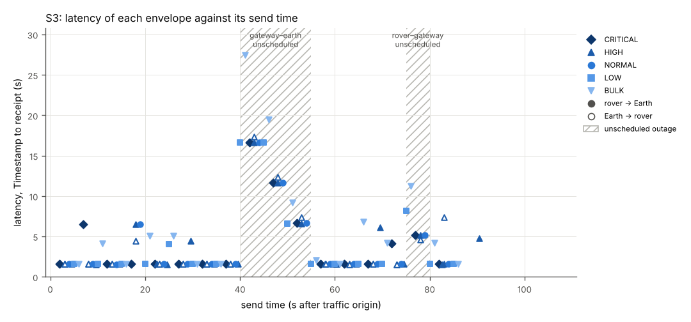

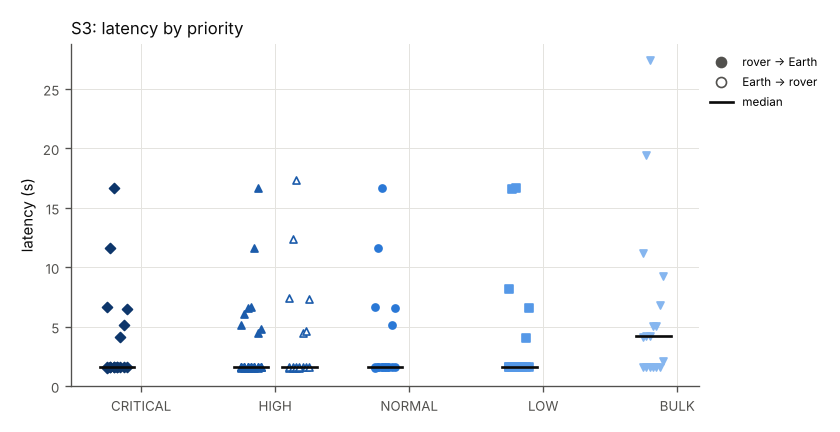

### PBS conformance items exercised

| Item | How |
|---|---|
| PBS-C02-T011 | delivery through unscheduled outages and random loss (S3-1, S3-2) |
| PBS-C02-T002 | S3-3: headers unchanged after LTP retransmission |
| PBS-CONFORMANCE-01 4.2 | receive processing of every delivered envelope (S3-4) |
| PBS-CONFORMANCE-02 Section 4 (complete outage, service restoration, link impairment model) | 5 % random loss on every direction plus two blackouts unknown to ION |

Files: `./S3/` (scenario definition `scenario.json`, contact plan `contacts.ionrc`, emulator configuration `emulator.json`, endpoint plans `rover-plan.json` and `earth-plan.jsonl`, endpoint logs `endpoint-a.jsonl` and `endpoint-b.jsonl`, emulator log `emulator.jsonl`, node logs `ion/`, tables `envelopes.csv`, `receipts.csv`, `links.csv`, `ionstats.csv`, verdict `verdict.json`).

## S4: Priority under a rate-limited link

Result: **PASS** (12 of 12 criteria passed).

The rover-Gateway leg is limited to 4000 bytes/s in the contact plan (so ION meters bundles onto the link at that rate) and to 4400 bytes/s with a 65536-byte drop-tail queue in the emulator (10 % above the contact rate for LTP and UDP header overhead). At 2 s the rover queues 40 BULK envelopes of 3000 bytes (about 30 s of link time); from 6 s it sends five small envelopes each of CRITICAL, HIGH, NORMAL and LOW, 3 s apart. ION's bpclm serves the urgent queue (expedited class: CRITICAL, HIGH) before any other, and shares the remaining capacity between the standard queue (NORMAL) and the bulk queue (LOW, BULK) in proportion 2:1 by bytes sent (bpv7/daemon/bpclm.c; docs/MAPPING-PROFILE.md). CRITICAL, HIGH and NORMAL are expected to arrive ahead of the BULK backlog; LOW shares ION's bulk queue with BULK and is expected to wait behind it.

### Conditions

- Traffic phase: 60 s after the traffic origin; contact-plan reference time T0 = origin - 10 s (2026/10/07-07:28:50 UTC); traffic origin 2026-10-07 07:29:00 UTC.
- Drain after the traffic phase: ended at 60.000 s (0.000 s after the traffic phase), every envelope handed to ION had been received or its bundle lifetime had ended; endpoints stopped then.
- Endpoint A plan origin: -0.001 s from the traffic origin (bin/rover start-up 0.099 s); Endpoint B plan origin: the traffic origin (`--t0-us`).
- Legs: rover-gateway: one-way delay 0.25 s (emulator), contact-plan range 1 s, contact rate 4000 bytes/s; gateway-earth: one-way delay 1.3 s (emulator), contact-plan range 2 s, contact rate 125000 bytes/s.
- Emulator forwarding accuracy: 624 datagrams forwarded; send time minus scheduled time median 0.792 ms, p99 2.525 ms, max 4.130 ms.
- Emulator settings beyond the delays: rover-gateway: rate_Bps=4400, queue_bytes=65536; gateway-rover: rate_Bps=4400, queue_bytes=65536 (`*` = all four directions); loss seed 4.
- No outage.
- Envelopes built (send records, including not sent): A->B: CRITICAL 5, HIGH 7, NORMAL 5, LOW 5, BULK 40; B->A: HIGH 2.

### Criteria

| ID | Criterion | Measured | Result |
|---|---|---|---|
| S4-1 | Every rover envelope handed to ION is received at Earth | 62 of 62 delivered (ratio 1.000) | PASS |
| S4-2 | Every Earth command handed to ION is received at the rover | 2 of 2 delivered (ratio 1.000) | PASS |
| S4-3 | Every received envelope is byte-identical to the envelope handed to ION | 64 of 64 received envelopes byte-identical (SHA-256 and header) | PASS |
| S4-4 | Every received envelope is accepted | 64 of 64: ACCEPT OK | PASS |
| S4-5 | CRITICAL and HIGH envelopes (PING replies included) arrive within 4.0 s despite the BULK backlog | n=12 min 2.096 s median 2.622 s max 2.917 s | PASS |
| S4-6 | NORMAL envelopes arrive within 4.0 s despite the BULK backlog | n=5 min 2.132 s median 2.181 s max 2.457 s | PASS |
| S4-7 | Every CRITICAL, HIGH and NORMAL envelope arrives before at least one BULK envelope that was sent before it | 17 envelopes; each overtook min 18 / max 33 earlier-sent envelopes of the other group | PASS |
| S4-8 | The slowest CRITICAL or HIGH envelope is faster than the median BULK envelope | CRITICAL+HIGH max = 2.917 s; BULK median = 16.968 s | PASS |
| S4-9 | LOW envelopes (ION bulk class, same as BULK) do not overtake BULK envelopes sent before them | 5 envelopes; 0 overtook an earlier-sent envelope of the other group | PASS |
| S4-10 | The emulator queue never overflowed (the backlog was held in ION) | drop_queue_full total 0 (rover-gateway=0) | PASS |
| S4-11 | Every send uses the class of service of SPEC-DIGEST 7.5 for its priority | 64 of 64 sends used the 7.5 class of service | PASS |
| S4-12 | No duplicate or unknown envelope is received | 64 recv records, 0 without a matching send record | PASS |
| S4-13 | BULK latency (informative) | n=40 min 2.302 s median 16.968 s max 31.856 s | info |
| S4-14 | LOW latency (informative) | n=5 min 16.764 s median 22.694 s max 28.620 s | info |
| S4-15 | Largest wait in the emulator queue, rover-gateway (informative) | max_queue_delay_s total 1.668 (rover-gateway=1.668) | info |

### Measurements

Delivery and latency per direction and priority (latency = receive time minus envelope Timestamp, both from the host clock; median = statistics.median; p95 = nearest rank, the value at position ceil(0.95 n) of the sorted latencies, which is the maximum when n < 20):

| Direction | Priority | Sent | Received | Delivery ratio | Min (s) | Median (s) | p95 (s) | Max (s) |
|---|---|---|---|---|---|---|---|---|
| A->B | CRITICAL | 5 | 5 | 1.000 | 2.096 | 2.388 | 2.663 | 2.663 |
| A->B | HIGH | 7 | 7 | 1.000 | 2.593 | 2.706 | 2.917 | 2.917 |
| A->B | NORMAL | 5 | 5 | 1.000 | 2.132 | 2.181 | 2.457 | 2.457 |
| A->B | LOW | 5 | 5 | 1.000 | 16.764 | 22.694 | 28.620 | 28.620 |
| A->B | BULK | 40 | 40 | 1.000 | 2.302 | 16.968 | 30.400 | 31.856 |
| B->A | HIGH | 2 | 2 | 1.000 | 1.637 | 1.641 | 1.644 | 1.644 |

Repeated deliveries: none; no envelope handed to ION once was delivered more than once.

Emulated links (counters from `emulator-stats.json`; LTP segment types decoded from each datagram; a data retransmission is a data segment whose session, offset and length the emulator had already seen on that link):

| Link | Delay (s) | Loss | Rate (B/s) | Queue (B) | Blackouts | Datagrams in | out | Lost (random) | Lost (blackout) | Lost (queue full) | LTP data segments | LTP reports | LTP cancels | LTP data retransmissions | Max queue wait (s) |
|---|---|---|---|---|---|---|---|---|---|---|---|---|---|---|---|
| earth-gateway | 1.3 | 0.0 | none | none | none | 66 | 66 | 0 | 0 | 0 | 2 | 62 | 0 | 0 | 0.0 |
| gateway-earth | 1.3 | 0.0 | none | none | none | 246 | 246 | 0 | 0 | 0 | 182 | 2 | 0 | 0 | 0.0 |
| gateway-rover | 0.25 | 0.0 | 4400.0 | 65536 | none | 66 | 66 | 0 | 0 | 0 | 2 | 62 | 0 | 0 | 0.001826 |
| rover-gateway | 0.25 | 0.0 | 4400.0 | 65536 | none | 246 | 246 | 0 | 0 | 0 | 182 | 2 | 0 | 0 | 1.667864 |

ION bundle counters per node (last `bpstats` report in the node's ion.log, cumulative since node start: sourced, forwarded, transmitted, received, delivered, reforwarded, deleted at lifetime expiry):

| Node | src | fwd | xmt | rcv | dlv | rfw | exp |
|---|---|---|---|---|---|---|---|
| rover | 62 | 62 | 62 | 2 | 2 | 0 | 0 |
| gateway | 0 | 64 | 64 | 64 | 0 | 0 | 0 |
| earth | 2 | 2 | 2 | 62 | 62 | 0 | 0 |

ION LTP span counters per node and span (`ltpstats -a` after the traffic phase; export = blocks this node sent on the span, import = blocks it received; screened = segments discarded because they arrived while the contact plan gave the sender no transmission to this node; backlog = red segments discarded because the blocks waiting for delivery to BP had reached the `m maxbacklog` limit, counted by ION as in_seg_too_fast):

| Node to peer | Checkpoints sent | Checkpoints resent | Data segments resent | Export cancels | Exports complete | Imports complete | Reports resent | Redundant segments in | Screened segments in | Backlog-discarded segments in |
|---|---|---|---|---|---|---|---|---|---|---|
| rover to gateway | 62 | 0 | 0 | 0 | 62 | 2 | 0 | 0 | 0 | 0 |
| gateway to earth | 62 | 0 | 0 | 0 | 62 | 2 | 0 | 0 | 0 | 0 |
| gateway to rover | 2 | 0 | 0 | 0 | 2 | 62 | 0 | 0 | 0 | 0 |
| earth to gateway | 2 | 0 | 0 | 0 | 2 | 62 | 0 | 0 | 0 | 0 |

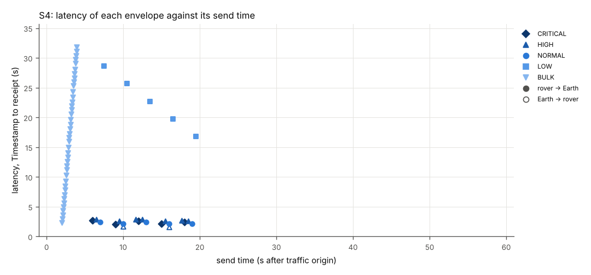

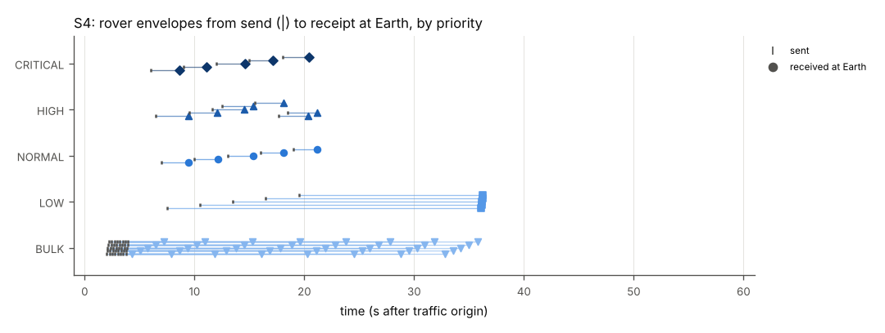

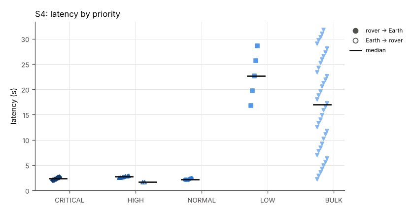

### PBS conformance items exercised

| Item | How |
|---|---|
| PBS-C02-T012 | partial: higher-priority envelopes forwarded ahead of a lower-priority backlog under constrained throughput (S4-5 to S4-8); no authorized degradation policy (PBS-QOS-MAP-01) is defined or applied |
| PBS-C02-T010 | partial: one ION class of service per priority per SPEC-DIGEST 7.5 and docs/MAPPING-PROFILE.md (S4-11); LOW and BULK share the bulk class (S4-9). One static mapping, with no network state input and no policy version |
| PBS-CONFORMANCE-01 6 | priority handling observed end to end |
| PBS-PRIO-01 4, 6; PBS-DTN-MAP-01 6.3; PBS-DTN-MAP-02 5, 10 (priority semantic preservation) | priority byte unchanged (S4-3) and mapped to ION class of service; the mapping profile with the four PBS-DTN-MAP-02 Section 5 items is docs/MAPPING-PROFILE.md |
| PBS-CONFORMANCE-02 Section 4 (constrained throughput) | 4000 bytes/s contact rate, 4400 bytes/s emulated link |

Files: `./S4/` (scenario definition `scenario.json`, contact plan `contacts.ionrc`, emulator configuration `emulator.json`, endpoint plans `rover-plan.json` and `earth-plan.jsonl`, endpoint logs `endpoint-a.jsonl` and `endpoint-b.jsonl`, emulator log `emulator.jsonl`, node logs `ion/`, tables `envelopes.csv`, `receipts.csv`, `links.csv`, `ionstats.csv`, verdict `verdict.json`).

## S5: Expiry: bundle lifetime during an outage, and receivers rejecting expired envelopes

Result: **PASS** (20 of 20 criteria passed).

The rover-Gateway leg has a scheduled outage from 20 s to 50 s. During it both endpoints send short-TTL envelopes (TTL 10 s and 20 s) whose bundle lifetime, computed from the TTL per PBS-DTN-MAP-01 6.1, ends before the contact resumes, together with control envelopes (TTL 60, TTL 0 and a TTL 30 command) that outlive it. Before the outage, each endpoint offers TTL 1 and TTL 2 envelopes (too short to send; Endpoint B's TTL 2 envelope carries a Timestamp 1 ms in the past) and sends one TTL 1 envelope with a bundle lifetime override of 60 s (fault injection, not conformant to PBS-DTN-MAP-01 6.1) so that an expired envelope reaches the other receiver. TTL 3 envelopes and a TTL 2 envelope handed over at its Timestamp are sent as observations. Earth's telemetry envelopes are signed (SPEC-DIGEST A38); an expired one is rejected at the TTL step, before authentication.

### Conditions

- Traffic phase: 70 s after the traffic origin; contact-plan reference time T0 = origin - 10 s (2026/10/07-07:30:30 UTC); traffic origin 2026-10-07 07:30:40 UTC.
- Drain after the traffic phase: ended at 70.000 s (0.000 s after the traffic phase), every envelope handed to ION had been received or its bundle lifetime had ended; endpoints stopped then.
- Endpoint A plan origin: -0.010 s from the traffic origin (bin/rover start-up 0.090 s); Endpoint B plan origin: the traffic origin (`--t0-us`).
- Legs: rover-gateway: one-way delay 0.25 s (emulator), contact-plan range 1 s, contact rate 125000 bytes/s; gateway-earth: one-way delay 1.3 s (emulator), contact-plan range 2 s, contact rate 125000 bytes/s.
- Emulator forwarding accuracy: 120 datagrams forwarded; send time minus scheduled time median 0.876 ms, p99 2.276 ms, max 2.359 ms.
- Emulator: delay only; no loss, no rate limit.
- Outage 20 s to 50 s on rover-gateway (scheduled): rover out of view of the Gateway (planned).
- Envelopes built (send records, including not sent): A->B: CRITICAL 2, HIGH 3, NORMAL 18; B->A: HIGH 4, NORMAL 10.

### Criteria

| ID | Criterion | Measured | Result |
|---|---|---|---|
| S5-1 | Both endpoints refuse to send a TTL 1 envelope (lifetime bound below 1 ms after the 1 s margin) | 2 of 2: NOT_SENT GW_EXPIRED | PASS |
| S5-2 | Both endpoints refuse to send a TTL 2 envelope (lifetime bound below the 1 s ION minimum) | 2 of 2: NOT_SENT GW_LIFETIME_UNDER_1S | PASS |
| S5-3 | Receivers reject expired envelopes delivered by ION (PBS-ENV-01 12.2), including an expired command before authentication | 3 of 3: REJECT TTL_EXPIRED | PASS |
| S5-4 | No TTL 10 or TTL 20 envelope sent during the outage is delivered (bundle lifetime ended in storage) | 0 of 11 delivered | PASS |
| S5-5 | TTL 60, TTL 0 and TTL 30 envelopes sent during the outage are delivered and accepted | 9 of 9: ACCEPT OK | PASS |
| S5-6 | Rover control envelopes arrive after the contact resumes (50 s + 1.55 s) | 6 received; earliest receipt at 53.092 s | PASS |
| S5-7 | Earth control envelopes arrive after the contact resumes (50 s + 0.25 s) | 3 received; earliest receipt at 51.485 s | PASS |
| S5-8 | At 26 s the rover node holds the 8 short-TTL rover envelopes | rover node held 8 matching bundles at 26.000 s (all bundles: 14) | PASS |
| S5-9 | At 36 s the TTL 10 envelopes (bundle lifetime 8 s) are gone from the rover node | rover node held 0 matching bundles at 36.000 s (all bundles: 10) | PASS |
| S5-10 | At 36 s the TTL 20 envelopes (bundle lifetime 18 s) are still held | rover node held 4 matching bundles at 36.000 s (all bundles: 10) | PASS |
| S5-11 | At 46 s no short-TTL envelope is left at the rover node | rover node held 0 matching bundles at 46.000 s (all bundles: 6) | PASS |
| S5-12 | At 46 s the TTL 60 and TTL 0 envelopes are still held at the rover node | rover node held 6 matching bundles at 46.000 s (all bundles: 6) | PASS |
| S5-13 | At 26.4 s the Earth node holds the three TTL 10 Earth envelopes (not forwarded: no route arrives before their lifetime ends) | earth node held 3 matching bundles at 26.400 s (all bundles: 5) | PASS |
| S5-14 | At 36.4 s they are gone from the Earth node | earth node held 0 matching bundles at 36.400 s (all bundles: 0) | PASS |
| S5-15 | The rover node's bpstats count the short-TTL bundles as deleted at lifetime expiry | rover node bpstats: 9 bundles deleted at lifetime expiry | PASS |
| S5-16 | The Earth node's bpstats count the Earth short-TTL bundles as deleted at lifetime expiry | earth node bpstats: 4 bundles deleted at lifetime expiry | PASS |
| S5-17 | Envelopes before and after the outage are delivered and accepted | 4 of 4: ACCEPT OK | PASS |
| S5-18 | No receiver accepts an envelope older than its TTL | 15 accepted envelopes with TTL > 0; 0 older than their TTL | PASS |
| S5-19 | No duplicate or unknown envelope is received | 20 recv records, 0 without a matching send record | PASS |
| S5-20 | At 26.8 s the Gateway node holds the Earth TTL 60 envelopes and the command, waiting for the rover contact | gateway node held 3 matching bundles at 26.800 s (all bundles: 3) | PASS |
| S5-21 | Observed: TTL 3 envelopes (bundle lifetime 1 s at A, 2 s at B) and B's TTL 2 envelope handed over at its Timestamp (lifetime 1 s); the contact-plan ranges on the path sum to 3 s (informative) | A->B S5-TTL3 TTL 3 s, bundle lifetime 1 s: not delivered; B->A S5-TTL3 TTL 3 s, bundle lifetime 2 s: ACCEPT OK, latency 1.576 s; B->A S5-TTL2-ZERO-AGE TTL 2 s, bundle lifetime 1 s: not delivered | info |

### Measurements

Delivery and latency per direction and priority (latency = receive time minus envelope Timestamp, both from the host clock; median = statistics.median; p95 = nearest rank, the value at position ceil(0.95 n) of the sorted latencies, which is the maximum when n < 20):

| Direction | Priority | Sent | Received | Delivery ratio | Min (s) | Median (s) | p95 (s) | Max (s) |
|---|---|---|---|---|---|---|---|---|
| A->B | CRITICAL | 2 | 2 | 1.000 | 27.630 | 28.614 | 29.599 | 29.599 |
| A->B | HIGH | 3 | 3 | 1.000 | 1.575 | 1.578 | 1.641 | 1.641 |
| A->B | NORMAL | 16 | 7 | 0.438 | 1.575 | 27.155 | 30.140 | 30.140 |
| B->A | HIGH | 4 | 4 | 1.000 | 1.575 | 1.577 | 26.485 | 26.485 |
| B->A | NORMAL | 8 | 4 | 0.500 | 1.574 | 14.293 | 27.994 | 27.994 |

Envelopes sent during an outage. Time held = latency minus the 1.55 s one-way propagation of the path. Leg resumed = first datagram the emulator received on either direction of the leg after the outage ended, minus the end time. Delivered after = receive time minus the end of the outage:

| Outage | Direction | Sent | Received | Time held min (s) | median (s) | max (s) | Leg resumed after (s) | Delivered after, first (s) | last (s) |
|---|---|---|---|---|---|---|---|---|---|
| rover-gateway 20-50 s (scheduled) | A->B | 14 | 6 | 25.605 | 27.098 | 28.590 | 1.229 | 3.092 | 3.146 |
| rover-gateway 20-50 s (scheduled) | B->A | 6 | 3 | 24.935 | 25.460 | 26.444 | 1.229 | 1.485 | 1.510 |

LTP blocks whose first checkpoint segment the emulator forwarded in the 3 s after the leg resumed; a block counts as resent when the sender transmitted its checkpoint again before any report segment for it came back; report delay = first report minus first checkpoint (emulator receive times):

| Outage | Data direction | Leg resumed after (s) | Blocks | Checkpoint resent before a report | Report delay min (s) | median (s) | max (s) |
|---|---|---|---|---|---|---|---|
| rover-gateway 20-50 s (scheduled) | rover-gateway | 1.229 | 7 | 0 | 0.254 | 0.265 | 0.271 |
| rover-gateway 20-50 s (scheduled) | gateway-rover | 1.229 | 3 | 0 | 0.252 | 0.253 | 0.254 |

Bundles held in ION storage (`bplist` on the node during the run; each bundle's payload identified as a demo envelope by Sequence and Timestamp):

| Probe | Node | At (s) | Bundles | Envelopes by label |
|---|---|---|---|---|
| rover at 26 s | rover | 26.0 | 14 | S5-TTL0-IN-OUTAGE x2; S5-TTL10-IN-OUTAGE x4; S5-TTL20-IN-OUTAGE x4; S5-TTL60-IN-OUTAGE x4 |
| Earth at 26.4 s | earth | 26.4 | 5 | S5-CMD-IN-OUTAGE x1; S5-TTL10-IN-OUTAGE x3; S5-TTL60-IN-OUTAGE x1 |
| Gateway at 26.8 s | gateway | 26.8 | 3 | S5-CMD-IN-OUTAGE x1; S5-TTL60-IN-OUTAGE x2 |
| rover at 36 s | rover | 36.0 | 10 | S5-TTL0-IN-OUTAGE x2; S5-TTL20-IN-OUTAGE x4; S5-TTL60-IN-OUTAGE x4 |
| Earth at 36.4 s | earth | 36.4 | 0 | none |
| rover at 46 s | rover | 46.0 | 6 | S5-TTL0-IN-OUTAGE x2; S5-TTL60-IN-OUTAGE x4 |

Repeated deliveries: none; no envelope handed to ION once was delivered more than once.

Expiry outcomes by label (lifetime = bundle lifetime passed to ION, DTN-MAP-01-6.1 = computed from the TTL, OVERRIDE = fault injection):

| Label | Direction | TTL (s) | Lifetime (s) | Lifetime rule | Envelopes | Outcome |
|---|---|---|---|---|---|---|
| S5-GW-TTL1 | A->B | 1 | not sent | DTN-MAP-01-6.1 | 1 | NOT_SENT GW_EXPIRED x1 |
| S5-GW-TTL1 | B->A | 1 | not sent | DTN-MAP-01-6.1 | 1 | NOT_SENT GW_EXPIRED x1 |
| S5-GW-TTL2 | A->B | 2 | not sent | DTN-MAP-01-6.1 | 1 | NOT_SENT GW_LIFETIME_UNDER_1S x1 |
| S5-GW-TTL2 | B->A | 2 | not sent | DTN-MAP-01-6.1 | 1 | NOT_SENT GW_LIFETIME_UNDER_1S x1 |
| S5-TTL2-ZERO-AGE | B->A | 2 | 1 | DTN-MAP-01-6.1 | 1 | not delivered x1 |
| S5-TTL3 | A->B | 3 | 1 | DTN-MAP-01-6.1 | 1 | not delivered x1 |
| S5-TTL3 | B->A | 3 | 2 | DTN-MAP-01-6.1 | 1 | ACCEPT OK x1 |
| S5-INJECT-EXPIRED | A->B | 1 | 60 | OVERRIDE | 1 | REJECT TTL_EXPIRED x1 |
| S5-INJECT-EXPIRED | B->A | 1 | 60 | OVERRIDE | 1 | REJECT TTL_EXPIRED x1 |
| S5-PRE | A->B | 60 | 58 | DTN-MAP-01-6.1 | 1 | ACCEPT OK x1 |
| S5-PRE | B->A | 30 | 29 | DTN-MAP-01-6.1 | 1 | ACCEPT OK x1 |
| S5-INJECT-EXPIRED-CMD | B->A | 1 | 60 | OVERRIDE | 1 | REJECT TTL_EXPIRED x1 |
| S5-TTL10-IN-OUTAGE | A->B | 10 | 8 | DTN-MAP-01-6.1 | 4 | not delivered x4 |
| S5-TTL10-IN-OUTAGE | B->A | 10 | 9 | DTN-MAP-01-6.1 | 3 | not delivered x3 |
| S5-TTL20-IN-OUTAGE | A->B | 20 | 18 | DTN-MAP-01-6.1 | 4 | not delivered x4 |
| S5-TTL60-IN-OUTAGE | A->B | 60 | 58 | DTN-MAP-01-6.1 | 4 | ACCEPT OK x4 |
| S5-TTL60-IN-OUTAGE | B->A | 60 | 59 | DTN-MAP-01-6.1 | 2 | ACCEPT OK x2 |
| S5-TTL0-IN-OUTAGE | A->B | 0 | 2147483647 | DTN-MAP-01-6.1 | 2 | ACCEPT OK x2 |
| S5-CMD-IN-OUTAGE | B->A | 30 | 29 | DTN-MAP-01-6.1 | 1 | ACCEPT OK x1 |
| S5-POST | A->B | 60 | 58 | DTN-MAP-01-6.1 | 1 | ACCEPT OK x1 |
| S5-POST | B->A | 30 | 29 | DTN-MAP-01-6.1 | 1 | ACCEPT OK x1 |

Emulated links (counters from `emulator-stats.json`; LTP segment types decoded from each datagram; a data retransmission is a data segment whose session, offset and length the emulator had already seen on that link):

| Link | Delay (s) | Loss | Rate (B/s) | Queue (B) | Blackouts | Datagrams in | out | Lost (random) | Lost (blackout) | Lost (queue full) | LTP data segments | LTP reports | LTP cancels | LTP data retransmissions | Max queue wait (s) |
|---|---|---|---|---|---|---|---|---|---|---|---|---|---|---|---|
| earth-gateway | 1.3 | 0.0 | none | none | none | 28 | 28 | 0 | 0 | 0 | 8 | 12 | 0 | 0 | 0.0 |
| gateway-earth | 1.3 | 0.0 | none | none | none | 32 | 32 | 0 | 0 | 0 | 12 | 8 | 0 | 0 | 0.0 |
| gateway-rover | 0.25 | 0.0 | none | none | 20-50 scheduled | 28 | 28 | 0 | 0 | 0 | 8 | 12 | 0 | 0 | 0.0 |
| rover-gateway | 0.25 | 0.0 | none | none | 20-50 scheduled | 32 | 32 | 0 | 0 | 0 | 12 | 8 | 0 | 0 | 0.0 |

ION bundle counters per node (last `bpstats` report in the node's ion.log, cumulative since node start: sourced, forwarded, transmitted, received, delivered, reforwarded, deleted at lifetime expiry):

| Node | src | fwd | xmt | rcv | dlv | rfw | exp |
|---|---|---|---|---|---|---|---|
| rover | 21 | 12 | 12 | 8 | 8 | 0 | 9 |
| gateway | 0 | 20 | 20 | 20 | 0 | 0 | 0 |
| earth | 12 | 8 | 8 | 12 | 12 | 0 | 4 |

ION LTP span counters per node and span (`ltpstats -a` after the traffic phase; export = blocks this node sent on the span, import = blocks it received; screened = segments discarded because they arrived while the contact plan gave the sender no transmission to this node; backlog = red segments discarded because the blocks waiting for delivery to BP had reached the `m maxbacklog` limit, counted by ION as in_seg_too_fast):

| Node to peer | Checkpoints sent | Checkpoints resent | Data segments resent | Export cancels | Exports complete | Imports complete | Reports resent | Redundant segments in | Screened segments in | Backlog-discarded segments in |
|---|---|---|---|---|---|---|---|---|---|---|
| rover to gateway | 12 | 0 | 0 | 0 | 12 | 8 | 0 | 0 | 0 | 0 |
| gateway to earth | 12 | 0 | 0 | 0 | 12 | 8 | 0 | 0 | 0 | 0 |
| gateway to rover | 8 | 0 | 0 | 0 | 8 | 12 | 0 | 0 | 0 | 0 |
| earth to gateway | 8 | 0 | 0 | 0 | 8 | 12 | 0 | 0 | 0 | 0 |

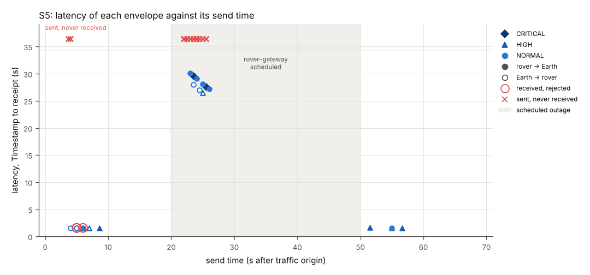

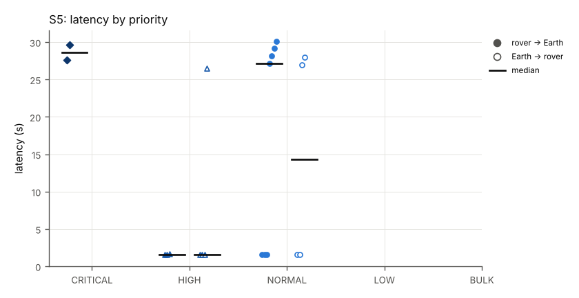

### PBS conformance items exercised

| Item | How |
|---|---|
| PBS-C02-T004 | expired envelopes rejected by both receivers with TTL_EXPIRED (S5-3) |
| PBS-C02-T011 | short-TTL envelopes not delivered after an outage longer than their lifetime; longer ones delivered (S5-4, S5-5) |
| PBS-C02-T016 | TTL 0 envelopes held through the outage with the no-expiry lifetime of docs/MAPPING-PROFILE.md and delivered (S5-5, S5-12) |
| PBS-CONFORMANCE-01 4.2, 9 | TTL check in receive order; discard and continue (S5-3, S5-17) |
| PBS-CONFORMANCE-01 8 (receiver side of statements 1 and 2) | receiver-side TTL checks at the clock values of statements 1 and 2 (vectors RX-01, RX-02, RX-04 and RX-05, both endpoints' unit tests and S7-1); the relay store-and-forward steps of the statements are not exercised: the demo has no PBS relay, and the gateway rule of PBS-DTN-MAP-01 6.1 does not encapsulate a TTL 30 envelope at T+30 s (vectors LT-05, LT-06) |
| PBS-CONFORMANCE-01 8 (discard envelopes with expired TTL) | applied by both endpoints as gateways before handing an envelope to ION: S5-1 (GW_EXPIRED) and S5-2 (GW_LIFETIME_UNDER_1S) |
| PBS-ENV-01 12.1 to 12.5; PBS-DTN-MAP-01 6.1, 6.1.1, 7.3; PBS-DTN-MAP-02 4, 10 (deadline-to-lifetime bounding, expiry during disruption, no-expiry lifetime) | S5-1, S5-2, S5-4, S5-8 to S5-16 |

Files: `./S5/` (scenario definition `scenario.json`, contact plan `contacts.ionrc`, emulator configuration `emulator.json`, endpoint plans `rover-plan.json` and `earth-plan.jsonl`, endpoint logs `endpoint-a.jsonl` and `endpoint-b.jsonl`, emulator log `emulator.jsonl`, node logs `ion/`, tables `envelopes.csv`, `receipts.csv`, `links.csv`, `ionstats.csv`, verdict `verdict.json`).

## S6: Authenticated commands: tamper, replay, wrong key, expiry, authorization

Result: **PASS** (8 of 8 criteria passed).

All links up. Mission Control (Endpoint B) sends 25 commands 1.5 s apart, signed with the demo TEST KEYS (Ed25519 suite 0xFF02 unless noted, HMAC-SHA-256 suite 0xFF01 where noted): valid commands, commands altered after signing (command byte, priority, TTL, Timestamp, security_sequence, Authority Context, CRC, MUX frame_count lowered to 1 and to 0), byte-identical replays, commands signed with keys the rover does not hold, an unknown key_id, an expired command, unauthorized and authorized roles, a wrong policy epoch, a validly signed command naming an authority the rover policy does not know, an unsigned command, a command without Authority Context, and a protected command carrying an unknown frame type. The rover (Endpoint A) verifies each one per PBS-SEC-B-01 and PBS-AUTH-01 and logs its disposition; tampering is applied by Endpoint B before the envelope is handed to ION and stands for modification in transit.

### Conditions

- Traffic phase: 44 s after the traffic origin; contact-plan reference time T0 = origin - 10 s (2026/10/07-07:32:20 UTC); traffic origin 2026-10-07 07:32:30 UTC.
- Drain after the traffic phase: ended at 44.000 s (0.000 s after the traffic phase), every envelope handed to ION had been received or its bundle lifetime had ended; endpoints stopped then.
- Endpoint A plan origin: +0.009 s from the traffic origin (bin/rover start-up 0.109 s); Endpoint B plan origin: the traffic origin (`--t0-us`).
- Legs: rover-gateway: one-way delay 0.25 s (emulator), contact-plan range 1 s, contact rate 125000 bytes/s; gateway-earth: one-way delay 1.3 s (emulator), contact-plan range 2 s, contact rate 125000 bytes/s.
- Emulator forwarding accuracy: 198 datagrams forwarded; send time minus scheduled time median 0.706 ms, p99 2.301 ms, max 4.240 ms.
- Emulator: delay only; no loss, no rate limit.
- No outage.
- Envelopes built (send records, including not sent): A->B: HIGH 1, NORMAL 7; B->A: CRITICAL 1, HIGH 24.

### Criteria

| ID | Criterion | Measured | Result |
|---|---|---|---|
| S6-1 | Each command gets the expected disposition at the rover | 25 labels checked | PASS |
| S6-2 | Only the five accepted commands are executed (logged), in order | executed: DRIVE, SET_HEATER, CAPTURE_IMAGE, PING, SET_MODE | PASS |
| S6-3 | Every command envelope handed to ION is received at the rover | 25 of 25 delivered (ratio 1.000) | PASS |
| S6-4 | The rover receives the bytes Endpoint B handed to ION (tampered bytes included) | 25 of 25 received envelopes byte-identical (SHA-256 and header) | PASS |
| S6-5 | Every recv record (audit line) matches an envelope that was sent; no duplicates | 33 recv records, 0 without a matching send record | PASS |
| S6-6 | Rover telemetry and the PING reply continue to arrive and are accepted | 8 of 8: ACCEPT OK | PASS |
| S6-7 | No receiver accepts an envelope older than its TTL | 13 accepted envelopes with TTL > 0; 0 older than their TTL | PASS |
| S6-8 | A valid command sent after the rejected ones is accepted; the measured value gives the number of envelopes the rover rejected before it | S6-21-VALID-AFTER-REJECTS received ACCEPT OK after 17 rejected envelopes at receiver A (AUTHZ_DENIED 2, AUTH_CTX_MISSING 1, CRC 1, SEC_AUTH_FAIL 8, SEC_KEY_UNKNOWN 1, SEC_MISSING 1, SEC_REPLAY 2, TTL_EXPIRED 1) | PASS |

### Measurements

Delivery and latency per direction and priority (latency = receive time minus envelope Timestamp, both from the host clock; median = statistics.median; p95 = nearest rank, the value at position ceil(0.95 n) of the sorted latencies, which is the maximum when n < 20):

| Direction | Priority | Sent | Received | Delivery ratio | Min (s) | Median (s) | p95 (s) | Max (s) |
|---|---|---|---|---|---|---|---|---|
| A->B | HIGH | 1 | 1 | 1.000 | 1.578 | 1.578 | 1.578 | 1.578 |
| A->B | NORMAL | 7 | 7 | 1.000 | 1.574 | 1.577 | 1.582 | 1.582 |
| B->A | CRITICAL | 1 | 1 | 1.000 | 1.575 | 1.575 | 1.575 | 1.575 |
| B->A | HIGH | 24 | 24 | 1.000 | -8.424 | 1.579 | 13.576 | 13.586 |

Repeated deliveries: none; no envelope handed to ION once was delivered more than once.

Command dispositions at the rover (Endpoint A), in send order. Latency is measured from the envelope Timestamp: a replay carries the Timestamp of its original, and the Timestamp-tamper case carries a Timestamp 10 s in the future, so its latency is negative:

| Label | Command | Suite | key_id | security_sequence | Rover result | Executed | Latency (s) |
|---|---|---|---|---|---|---|---|
| S6-01-VALID-ED25519 | DRIVE 10 | 0xFF02 | TEST-ED25519-01 | 1 | ACCEPT OK | 1 | 1.581 |
| S6-02-VALID-HMAC | SET_HEATER ON | 0xFF01 | TEST-HMAC-01 | 1 | ACCEPT OK | 1 | 1.581 |
| S6-03-TAMPER-COMMAND | DRIVE 18 | 0xFF02 | TEST-ED25519-01 | 2 | REJECT SEC_AUTH_FAIL | 0 | 1.580 |
| S6-04-TAMPER-PRIORITY | DRIVE 10 | 0xFF02 | TEST-ED25519-01 | 3 | REJECT SEC_AUTH_FAIL | 0 | 1.575 |
| S6-05-TAMPER-TTL | DRIVE 10 | 0xFF02 | TEST-ED25519-01 | 4 | REJECT SEC_AUTH_FAIL | 0 | 1.577 |
| S6-06-TAMPER-TIMESTAMP | DRIVE 10 | 0xFF02 | TEST-ED25519-01 | 5 | REJECT SEC_AUTH_FAIL | 0 | -8.424 |
| S6-07-TAMPER-SECSEQ | DRIVE 10 | 0xFF02 | TEST-ED25519-01 | 7 | REJECT SEC_AUTH_FAIL | 0 | 1.574 |
| S6-08-TAMPER-AUTHORITY | DRIVE 10 | 0xFF02 | TEST-ED25519-01 | 7 | REJECT SEC_AUTH_FAIL | 0 | 1.585 |
| S6-09-REPLAY-ED25519 | DRIVE 10 | 0xFF02 | TEST-ED25519-01 | 1 | REJECT SEC_REPLAY | 0 | 13.586 |
| S6-10-REPLAY-HMAC | SET_HEATER ON | 0xFF01 | TEST-HMAC-01 | 1 | REJECT SEC_REPLAY | 0 | 13.576 |
| S6-11-WRONG-KEY-ED25519 | DRIVE 10 | 0xFF02 | TEST-ED25519-01 | 8 | REJECT SEC_AUTH_FAIL | 0 | 1.577 |
| S6-12-WRONG-KEY-HMAC | SET_HEATER OFF | 0xFF01 | TEST-HMAC-01 | 2 | REJECT SEC_AUTH_FAIL | 0 | 1.578 |
| S6-13-UNKNOWN-KEY-ID | DRIVE 10 | 0xFF02 | TEST-ED25519-ROGUE | 1 | REJECT SEC_KEY_UNKNOWN | 0 | 1.578 |
| S6-14-EXPIRED | DRIVE 10 | 0xFF02 | TEST-ED25519-01 | 9 | REJECT TTL_EXPIRED | 0 | 1.575 |
| S6-15-ROLE-NOT-AUTHORIZED | DRIVE 10 | 0xFF02 | TEST-ED25519-01 | 10 | REJECT AUTHZ_DENIED | 0 | 1.573 |
| S6-16-ROLE-AUTHORIZED | CAPTURE_IMAGE NAVCAM | 0xFF02 | TEST-ED25519-01 | 11 | ACCEPT OK | 1 | 1.577 |
| S6-17-WRONG-POLICY-EPOCH | DRIVE 10 | 0xFF02 | TEST-ED25519-01 | 12 | REJECT AUTHZ_DENIED | 0 | 1.576 |
| S6-18-UNSIGNED | DRIVE 10 |  |  |  | REJECT SEC_MISSING | 0 | 1.584 |
| S6-19-NO-AUTHORITY-CONTEXT | DRIVE 10 | 0xFF02 | TEST-ED25519-01 | 13 | REJECT AUTH_CTX_MISSING | 0 | 1.588 |
| S6-20-BAD-CRC | DRIVE 10 | 0xFF02 | TEST-ED25519-01 | 14 | REJECT CRC | 0 | 1.577 |
| S6-21-VALID-AFTER-REJECTS | PING S6 | 0xFF02 | TEST-ED25519-01 | 15 | ACCEPT OK | 1 | 1.582 |
| S6-22-UNKNOWN-FRAME-PROTECTED | SET_MODE SAFE | 0xFF02 | TEST-ED25519-01 | 16 | ACCEPT OK | 1 | 1.580 |
| S6-23-TAMPER-FRAME-COUNT-1 |  |  |  |  | REJECT SEC_MISSING | 0 | 1.579 |
| S6-24-TAMPER-FRAME-COUNT-0 |  |  |  |  | REJECT SEC_MISSING | 0 | 1.582 |
| S6-25-AUTHORITY-NOT-AUTHORIZED | DRIVE 10 | 0xFF02 | TEST-ED25519-01 | 19 | REJECT AUTHZ_DENIED | 0 | 1.579 |

Emulated links (counters from `emulator-stats.json`; LTP segment types decoded from each datagram; a data retransmission is a data segment whose session, offset and length the emulator had already seen on that link):

| Link | Delay (s) | Loss | Rate (B/s) | Queue (B) | Blackouts | Datagrams in | out | Lost (random) | Lost (blackout) | Lost (queue full) | LTP data segments | LTP reports | LTP cancels | LTP data retransmissions | Max queue wait (s) |
|---|---|---|---|---|---|---|---|---|---|---|---|---|---|---|---|
| earth-gateway | 1.3 | 0.0 | none | none | none | 58 | 58 | 0 | 0 | 0 | 25 | 8 | 0 | 0 | 0.0 |
| gateway-earth | 1.3 | 0.0 | none | none | none | 41 | 41 | 0 | 0 | 0 | 8 | 25 | 0 | 0 | 0.0 |
| gateway-rover | 0.25 | 0.0 | none | none | none | 58 | 58 | 0 | 0 | 0 | 25 | 8 | 0 | 0 | 0.0 |
| rover-gateway | 0.25 | 0.0 | none | none | none | 41 | 41 | 0 | 0 | 0 | 8 | 25 | 0 | 0 | 0.0 |

ION bundle counters per node (last `bpstats` report in the node's ion.log, cumulative since node start: sourced, forwarded, transmitted, received, delivered, reforwarded, deleted at lifetime expiry):

| Node | src | fwd | xmt | rcv | dlv | rfw | exp |
|---|---|---|---|---|---|---|---|
| rover | 8 | 8 | 8 | 25 | 25 | 0 | 0 |
| gateway | 0 | 33 | 33 | 33 | 0 | 0 | 0 |
| earth | 25 | 25 | 25 | 8 | 8 | 0 | 0 |

ION LTP span counters per node and span (`ltpstats -a` after the traffic phase; export = blocks this node sent on the span, import = blocks it received; screened = segments discarded because they arrived while the contact plan gave the sender no transmission to this node; backlog = red segments discarded because the blocks waiting for delivery to BP had reached the `m maxbacklog` limit, counted by ION as in_seg_too_fast):

| Node to peer | Checkpoints sent | Checkpoints resent | Data segments resent | Export cancels | Exports complete | Imports complete | Reports resent | Redundant segments in | Screened segments in | Backlog-discarded segments in |
|---|---|---|---|---|---|---|---|---|---|---|
| rover to gateway | 8 | 0 | 0 | 0 | 8 | 25 | 0 | 0 | 0 | 0 |
| gateway to earth | 8 | 0 | 0 | 0 | 8 | 25 | 0 | 0 | 0 | 0 |
| gateway to rover | 25 | 0 | 0 | 0 | 25 | 8 | 0 | 0 | 0 | 0 |
| earth to gateway | 25 | 0 | 0 | 0 | 25 | 8 | 0 | 0 | 0 | 0 |

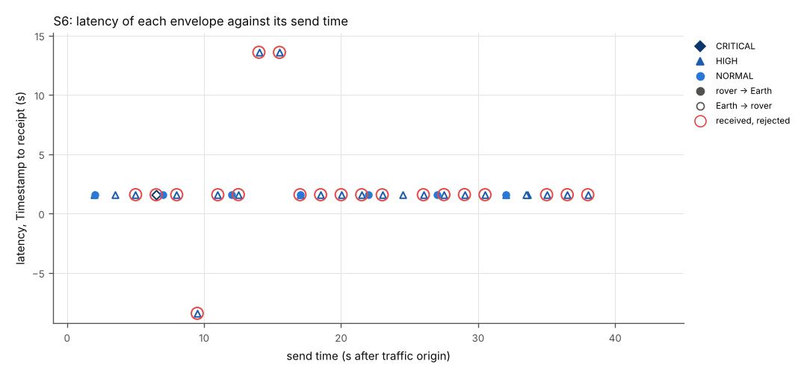

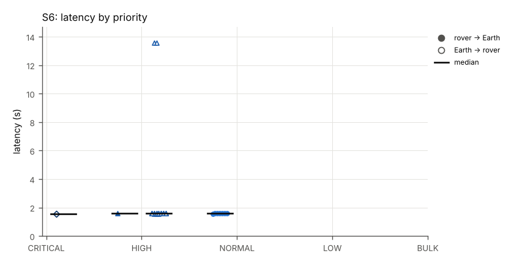

### PBS conformance items exercised

| Item | How |
|---|---|
| PBS-C02-T006 | modifications tested, each rejected: command byte, priority, TTL, Timestamp, security_sequence and Authority Context altered after signing (SEC_AUTH_FAIL, S6-03 to S6-08); CRC32 field altered (CRC, S6-20); MUX frame_count lowered to 1 and to 0 (SEC_MISSING, S6-23, S6-24); signatures by keys the rover does not hold (SEC_AUTH_FAIL, S6-11, S6-12) |
| PBS-C02-T007 | byte-identical replays rejected with SEC_REPLAY (S6-09, S6-10) |
| PBS-C02-T008 | unauthorized role (S6-15), wrong policy epoch (S6-17) and an authority the rover policy does not know in a validly signed command (S6-25) rejected with AUTHZ_DENIED; authorized role accepted (S6-16) |
| PBS-C02-T004 | expired command rejected with TTL_EXPIRED before authentication (S6-14) |
| PBS-C02-T014 | unknown frame type inside a protected command skipped and covered by authentication (S6-22) |
| PBS-C02-T015 | one recv audit record per command with reason code, one exec record per executed command (S6-2, S6-5) |
| PBS-CONFORMANCE-01 9 | a valid command sent after the rejected ones is accepted; S6-8 gives the number of rejections before it, counted from the rover's log |
| PBS-SECB-REQ-001 to PBS-SECB-REQ-007; PBS-AUTH-REQ-002, PBS-AUTH-REQ-003, PBS-AUTH-REQ-005, PBS-AUTH-REQ-006; PBS-PRIO-01 10 | S6-1, S6-2, S6-5 |

Files: `./S6/` (scenario definition `scenario.json`, contact plan `contacts.ionrc`, emulator configuration `emulator.json`, endpoint plans `rover-plan.json` and `earth-plan.jsonl`, endpoint logs `endpoint-a.jsonl` and `endpoint-b.jsonl`, emulator log `emulator.jsonl`, node logs `ion/`, tables `envelopes.csv`, `receipts.csv`, `links.csv`, `ionstats.csv`, verdict `verdict.json`).

## S7: Cross-implementation: each endpoint parses the other's envelopes; identical inputs give identical bytes

Result: **PASS** (9 of 9 criteria passed).

Offline, both endpoints build every vector of docs/test-vectors.json that has inputs and run every receiver case; the bytes and the dispositions are compared with each other and with the vector file. Live, both endpoints exchange envelopes of all five priorities, header-only envelopes, envelopes with ACK_REQ, envelopes of 30000 and 65536 bytes (Endpoint A) and 65000 bytes (Endpoint B), an unprotected envelope with an unknown frame type (Endpoint A), and signed envelopes with an unknown frame type, one of them a command (Endpoint B; Earth-MCC signs every envelope that has a payload, SPEC-DIGEST A38). Both endpoints log the bytes of every envelope (--log-hex-max 65580), and each endpoint's offline tool decodes every envelope the other logged as sent and compares every header field, the length and the SHA-256 with the sender's own record.

### Conditions

- Traffic phase: 25 s after the traffic origin; contact-plan reference time T0 = origin - 10 s (2026/10/07-07:33:43 UTC); traffic origin 2026-10-07 07:33:53 UTC.
- Drain after the traffic phase: ended at 25.000 s (0.000 s after the traffic phase), every envelope handed to ION had been received or its bundle lifetime had ended; endpoints stopped then.
- Endpoint A plan origin: +0.004 s from the traffic origin (bin/rover start-up 0.103 s); Endpoint B plan origin: the traffic origin (`--t0-us`).
- Legs: rover-gateway: one-way delay 0.25 s (emulator), contact-plan range 1 s, contact rate 125000 bytes/s; gateway-earth: one-way delay 1.3 s (emulator), contact-plan range 2 s, contact rate 125000 bytes/s.
- Emulator forwarding accuracy: 408 datagrams forwarded; send time minus scheduled time median 0.668 ms, p99 1.871 ms, max 2.866 ms.
- Emulator: delay only; no loss, no rate limit.
- No outage.
- Envelopes built (send records, including not sent): A->B: CRITICAL 1, HIGH 2, NORMAL 2, LOW 1, BULK 2; B->A: CRITICAL 1, HIGH 2, NORMAL 2, LOW 1, BULK 1.

### Criteria

| ID | Criterion | Measured | Result |
|---|---|---|---|
| S7-1 | For every vector with inputs, Endpoint A and Endpoint B build the same bytes, equal to the vector file; for every receiver and SEC-B case both give the expected result and reason | build: 36 items, A==B 36, A==expected 36, B==expected 36; receive: 23 items, A==B 23, A==expected 23, B==expected 23; sec_b: 34 items, A==B 34, A==expected 34, B==expected 34 | PASS |
| S7-2 | Endpoint A's vector run passes every check | a-vectors exit status 0 | PASS |
| S7-3 | The comparison program finds no difference | vector-comparison exit status 0 | PASS |
| S7-4 | Endpoint A decodes every envelope Endpoint B logged as sent (all have envelope_hex) with the same field values, and Endpoint B received every envelope A sent, byte-identical (the tool fails otherwise) | a-crosscheck exit status 0; decoded 7 of 7 peer send records (0 without bytes), 0 field mismatches; own envelopes delivered 8 of 8, byte-identical 8 | PASS |
| S7-5 | Endpoint B decodes every envelope Endpoint A logged as sent (all have envelope_hex) with the same field values, and Endpoint A received every envelope B sent, byte-identical (the tool fails otherwise) | b-crosscheck exit status 0; decoded 8 of 8 peer send records (0 without bytes), 0 field mismatches; own envelopes delivered 7 of 7, byte-identical 7 | PASS |
| S7-6 | Every envelope handed to ION is received by the other endpoint | 15 of 15 delivered (ratio 1.000) | PASS |
| S7-7 | Every received envelope is byte-identical to the envelope handed to ION | 15 of 15 received envelopes byte-identical (SHA-256 and header) | PASS |
| S7-8 | Each endpoint accepts every envelope of the other implementation | 15 of 15: ACCEPT OK | PASS |
| S7-9 | The protected command with an unknown frame type is executed | executed: PING | PASS |

### Measurements

Delivery and latency per direction and priority (latency = receive time minus envelope Timestamp, both from the host clock; median = statistics.median; p95 = nearest rank, the value at position ceil(0.95 n) of the sorted latencies, which is the maximum when n < 20):

| Direction | Priority | Sent | Received | Delivery ratio | Min (s) | Median (s) | p95 (s) | Max (s) |
|---|---|---|---|---|---|---|---|---|
| A->B | CRITICAL | 1 | 1 | 1.000 | 1.578 | 1.578 | 1.578 | 1.578 |
| A->B | HIGH | 2 | 2 | 1.000 | 1.579 | 1.581 | 1.584 | 1.584 |
| A->B | NORMAL | 2 | 2 | 1.000 | 1.573 | 1.586 | 1.599 | 1.599 |
| A->B | LOW | 1 | 1 | 1.000 | 1.582 | 1.582 | 1.582 | 1.582 |
| A->B | BULK | 2 | 2 | 1.000 | 1.655 | 1.658 | 1.662 | 1.662 |
| B->A | CRITICAL | 1 | 1 | 1.000 | 1.580 | 1.580 | 1.580 | 1.580 |
| B->A | HIGH | 2 | 2 | 1.000 | 1.580 | 1.584 | 1.588 | 1.588 |
| B->A | NORMAL | 2 | 2 | 1.000 | 1.577 | 1.587 | 1.598 | 1.598 |
| B->A | LOW | 1 | 1 | 1.000 | 1.593 | 1.593 | 1.593 | 1.593 |
| B->A | BULK | 1 | 1 | 1.000 | 1.688 | 1.688 | 1.688 | 1.688 |

Repeated deliveries: none; no envelope handed to ION once was delivered more than once.

Scope of this result. Endpoint A (Python; PBS_LINK 0.1.4 for the envelope; the cryptography package) and Endpoint B (C; its own CRC-32 and envelope code; OpenSSL libcrypto) are separate code bases: Endpoint A calls no C code, and Endpoint B's author did not open PBS_LINK or Endpoint A's protocol modules (endpoint-c/README.md). Both implement one interpretation document, docs/SPEC-DIGEST.md, which fixes the receive steps R1 to R14, every reason code and the demo choices A1 to A38. The digest was written, and docs/test-vectors.json generated, by a separate step that ran PBS_LINK 0.1.4; the expected results in the vectors come from the reference receiver in docs/gen_test_vectors.py, which was written with Endpoint A and has the same structure as Endpoint A's receiver. Agreement on reason codes, check order, canonicalization, the replay window and the lifetime rule follows from the shared digest. S7 shows code-level independence (separate code, language, cryptographic library and CRC implementation) and agreement with that shared interpretation; it does not show that two independent readings of PBS v1.5.0 agree on the A1 to A38 choices or the R1 to R14 reason codes.

Offline comparison (`scenarios/s7_compare.py`, docs/test-vectors.json SHA-256 `51e09856fa3c59130aa01f9c5d0e661a26cd19bda2aec74c45f8084bffd69b25`):

| Item kind | Items | A == B | A == expected | B == expected |
|---|---|---|---|---|
| build | 36 | 36 | 36 | 36 |
| receive | 23 | 23 | 23 | 23 |
| sec_b | 34 | 34 | 34 | 34 |

`a-crosscheck` output (Endpoint A `bin/tool crosscheck`):

```
{
 "peer_log": "/home/user/pbs-ion-demo-runs/run-F/results/S7/endpoint-b.jsonl",
 "peer_send_records": 7,
 "decoded": 7,
 "decode_mismatch": [],
 "no_hex": 0,
 "own_sent": 8,
 "delivered": 8,
 "byte_identical": 8,
 "byte_mismatch": [],
 "peer_duplicates": 0,
 "ok": true
}
```

`b-crosscheck` output (Endpoint B `pbs_tool crosscheck`):

```
{"impl":"endpoint-c 0.1.0","peer_log":"/home/user/pbs-ion-demo-runs/run-F/results/S7/endpoint-a.jsonl","peer_send_records":8,"decoded":8,"no_hex":0,"decode_mismatch_records":0,"decode_mismatch":[],"b_receive_accept":8,"b_receive_reject":0,"b_receive_reasons":{"OK":8},"own_log":"/home/user/pbs-ion-demo-runs/run-F/results/S7/endpoint-b.jsonl","own_sent":7,"delivered":7,"byte_identical":7,"peer_duplicates":0,"byte_mismatch":[],"ok":true}
```

Emulated links (counters from `emulator-stats.json`; LTP segment types decoded from each datagram; a data retransmission is a data segment whose session, offset and length the emulator had already seen on that link):

| Link | Delay (s) | Loss | Rate (B/s) | Queue (B) | Blackouts | Datagrams in | out | Lost (random) | Lost (blackout) | Lost (queue full) | LTP data segments | LTP reports | LTP cancels | LTP data retransmissions | Max queue wait (s) |
|---|---|---|---|---|---|---|---|---|---|---|---|---|---|---|---|
| earth-gateway | 1.3 | 0.0 | none | none | none | 87 | 87 | 0 | 0 | 0 | 72 | 8 | 0 | 0 | 0.0 |
| gateway-earth | 1.3 | 0.0 | none | none | none | 117 | 117 | 0 | 0 | 0 | 102 | 7 | 0 | 0 | 0.0 |
| gateway-rover | 0.25 | 0.0 | none | none | none | 87 | 87 | 0 | 0 | 0 | 72 | 8 | 0 | 0 | 0.0 |
| rover-gateway | 0.25 | 0.0 | none | none | none | 117 | 117 | 0 | 0 | 0 | 102 | 7 | 0 | 0 | 0.0 |

ION bundle counters per node (last `bpstats` report in the node's ion.log, cumulative since node start: sourced, forwarded, transmitted, received, delivered, reforwarded, deleted at lifetime expiry):

| Node | src | fwd | xmt | rcv | dlv | rfw | exp |
|---|---|---|---|---|---|---|---|
| rover | 8 | 8 | 8 | 7 | 7 | 0 | 0 |
| gateway | 0 | 15 | 15 | 15 | 0 | 0 | 0 |
| earth | 7 | 7 | 7 | 8 | 8 | 0 | 0 |

ION LTP span counters per node and span (`ltpstats -a` after the traffic phase; export = blocks this node sent on the span, import = blocks it received; screened = segments discarded because they arrived while the contact plan gave the sender no transmission to this node; backlog = red segments discarded because the blocks waiting for delivery to BP had reached the `m maxbacklog` limit, counted by ION as in_seg_too_fast):

| Node to peer | Checkpoints sent | Checkpoints resent | Data segments resent | Export cancels | Exports complete | Imports complete | Reports resent | Redundant segments in | Screened segments in | Backlog-discarded segments in |
|---|---|---|---|---|---|---|---|---|---|---|
| rover to gateway | 8 | 0 | 0 | 0 | 8 | 7 | 0 | 0 | 0 | 0 |
| gateway to earth | 8 | 0 | 0 | 0 | 8 | 7 | 0 | 0 | 0 | 0 |
| gateway to rover | 7 | 0 | 0 | 0 | 7 | 8 | 0 | 0 | 0 | 0 |
| earth to gateway | 7 | 0 | 0 | 0 | 7 | 8 | 0 | 0 | 0 | 0 |

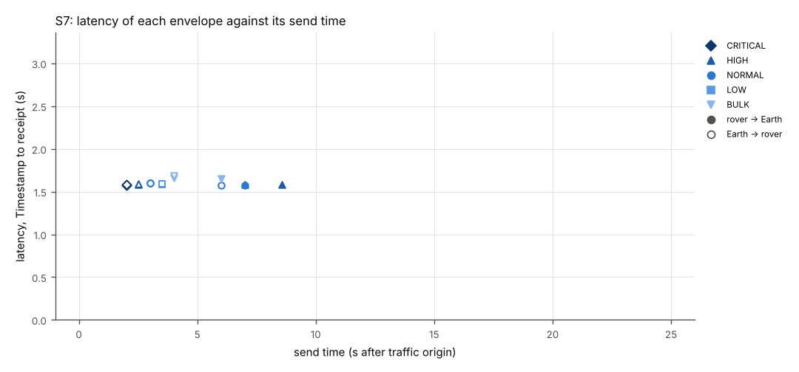

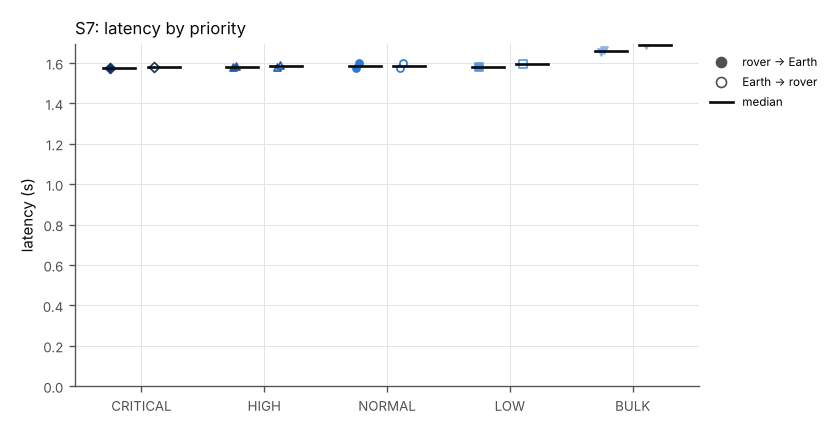

### PBS conformance items exercised

| Item | How |
|---|---|
| PBS-C02-T014 | unknown frame types skipped by both receivers: in an unprotected envelope (Endpoint A to B), in signed data and in a signed command (Endpoint B to A), live; vectors RX-21 and CMD-16 offline |
| PBS-C02-T002 | S7-7 |
| PBS-CONFORMANCE-01 4.1, 4.3, 5.1, 7, 10 | header layout, CRC-32, Sequence and envelope vectors built and parsed identically by both implementations (S7-1, S7-4, S7-5) |
| PBS-ENV-01 12.5, 13.2 | vectors ENV-01 to ENV-03 and RX-01 to RX-06 (S7-1) |

Files: `./S7/` (scenario definition `scenario.json`, contact plan `contacts.ionrc`, emulator configuration `emulator.json`, endpoint plans `rover-plan.json` and `earth-plan.jsonl`, endpoint logs `endpoint-a.jsonl` and `endpoint-b.jsonl`, emulator log `emulator.jsonl`, node logs `ion/`, tables `envelopes.csv`, `receipts.csv`, `links.csv`, `ionstats.csv`, verdict `verdict.json`).

## Repeatability

The same scenarios in 2 complete `./run_demo.sh` runs, in the order they were made. Values in one cell are given in that order (run F / run G). The range is the largest minus the smallest value across the runs.

| Run | First scenario started (UTC) | Demo commit | run_demo.sh total time | Self-checks | Scenarios passed |
|---|---|---|---|---|---|
| run F | 2026-10-07 07:22:33 | 25ffe97aa464 | 866 s | 4 of 4 passed | 7 of 7 |
| run G | 2026-10-07 07:37:11 | 25ffe97aa464 | 869 s | 4 of 4 passed | 7 of 7 |

### Verdicts

| Scenario | Result | Criteria passed | Wall time (s) | Clean ION stop |
|---|---|---|---|---|
| S1 | PASS / PASS | 13/13 / 13/13 | 79 / 80 | yes / yes |
| S2 | PASS / PASS | 15/15 / 15/15 | 145 / 144 | yes / yes |
| S3 | PASS / PASS | 9/9 / 9/9 | 149 / 150 | yes / yes |
| S4 | PASS / PASS | 12/12 / 12/12 | 100 / 99 | yes / yes |
| S5 | PASS / PASS | 20/20 / 20/20 | 110 / 110 | yes / yes |
| S6 | PASS / PASS | 8/8 / 8/8 | 83 / 84 | yes / yes |
| S7 | PASS / PASS | 9/9 / 9/9 | 65 / 65 | yes / yes |

### Measured value of every criterion

"Same" is yes when the measured text is identical in every run. Informative entries (no pass/fail) are marked (i).

73 of 100 criteria measured the same text in every run.

| Criterion | Result | Same | Measured |
|---|---|---|---|
| S1-1 | PASS / PASS | yes | 36 of 36 delivered (ratio 1.000) |
| S1-2 | PASS / PASS | yes | 10 of 10 delivered (ratio 1.000) |
| S1-3 | PASS / PASS | yes | 46 of 46 received envelopes byte-identical (SHA-256 and header) |
| S1-4 | PASS / PASS | yes | 46 of 46: ACCEPT OK |
| S1-5 | PASS / PASS | yes | executed: PING, SET_HEATER, DRIVE, CAPTURE_IMAGE, SET_MODE, PING, PING, PING |
| S1-6 | PASS / PASS | yes | 4 of 4 delivered (ratio 1.000) |
| S1-7 | PASS / PASS | no | run F: n=46 min 1.574 s median 1.582 s max 1.662 s<br>run G: n=46 min 1.572 s median 1.578 s max 1.618 s |
| S1-8 | PASS / PASS | yes | 7 of 7 sent with lifetime 2147483647 s |
| S1-9 | PASS / PASS | yes | 7 of 7 delivered (ratio 1.000) |
| S1-10 | PASS / PASS | yes | 46 of 46 sends used the 7.5 class of service |
| S1-11 | PASS / PASS | yes | 46 of 46 with the expected bundle source EID |
| S1-12 | PASS / PASS | yes | 46 recv records, 0 without a matching send record |
| S1-13 | PASS / PASS | yes | 39 accepted envelopes with TTL > 0; 0 older than their TTL |
| S2-1 | PASS / PASS | yes | 111 of 111 delivered (ratio 1.000) |
| S2-2 | PASS / PASS | yes | 16 of 16 delivered (ratio 1.000) |
| S2-3 | PASS / PASS | yes | 127 of 127 received envelopes byte-identical (SHA-256 and header) |
| S2-4 | PASS / PASS | yes | 127 of 127: ACCEPT OK |
| S2-5 | PASS / PASS | yes | rover node held 20 matching bundles at 45.000 s (all bundles: 21) |
| S2-6 | PASS / PASS | yes | gateway node held 3 matching bundles at 45.500 s (all bundles: 3) |
| S2-7 | PASS / PASS | yes | gateway node held 17 matching bundles at 80.000 s (all bundles: 17) |
| S2-8 | PASS / PASS | no | run F: earth node held 2 matching bundles at 80.500 s (all bundles: 3)<br>run G: earth node held 2 matching bundles at 80.500 s (all bundles: 2) |
| S2-9 | PASS / PASS | no | run F: 24 received; earliest receipt at 53.145 s<br>run G: 24 received; earliest receipt at 53.185 s |
| S2-10 | PASS / PASS | no | run F: 4 received; earliest receipt at 51.524 s<br>run G: 4 received; earliest receipt at 51.566 s |
| S2-11 | PASS / PASS | no | run F: 19 received; earliest receipt at 92.693 s<br>run G: 19 received; earliest receipt at 92.758 s |
| S2-12 | PASS / PASS | no | run F: 3 received; earliest receipt at 88.393 s<br>run G: 3 received; earliest receipt at 88.463 s |
| S2-13 | PASS / PASS | yes | 127 recv records, 0 without a matching send record |
| S2-14 | PASS / PASS | yes | 108 accepted envelopes with TTL > 0; 0 older than their TTL |
| S2-15 | PASS / PASS | yes | drop_blackout total 0 (rover-gateway=0, gateway-rover=0, gateway-earth=0, earth-gateway=0) |
| S2-16 (i) | info / info | yes | earth node, span to gateway: in_seg_screened = 34 (ltpstats -a) |
| S2-17 (i) | info / info | yes | gateway node, span to rover: in_seg_screened = 0 (ltpstats -a) |
| S2-18 (i) | info / info | yes | gateway node, span to earth: ckpt_re_xmit = 29 (ltpstats -a) |
| S2-19 (i) | info / info | no | run F: last receipt at 97.588 s; traffic phase ends at 105 s (margin 7.412 s); 0 receipts after it; drain ended at 105.0 s, every envelope handed to ION received or its lifetime ended<br>run G: last receipt at 97.587 s; traffic phase ends at 105 s (margin 7.413 s); 0 receipts after it; drain ended at 105.0 s, every envelope handed to ION received or its lifetime ended |
| S3-1 | PASS / PASS | yes | 102 of 102 delivered (ratio 1.000) |
| S3-2 | PASS / PASS | yes | 17 of 17 delivered (ratio 1.000) |
| S3-3 | PASS / PASS | yes | 119 of 119 received envelopes byte-identical (SHA-256 and header) |
| S3-4 | PASS / PASS | yes | 119 of 119: ACCEPT OK |
| S3-5 | PASS / PASS | no | run F: drop_loss total 56 (rover-gateway=17, gateway-rover=8, gateway-earth=26, earth-gateway=5)<br>run G: drop_loss total 50 (rover-gateway=15, gateway-rover=8, gateway-earth=23, earth-gateway=4) |
| S3-6 | PASS / PASS | no | run F: drop_blackout total 84 (gateway-earth=50, earth-gateway=19, rover-gateway=12, gateway-rover=3)<br>run G: drop_blackout total 84 (gateway-earth=49, earth-gateway=19, rover-gateway=12, gateway-rover=4) |
| S3-7 | PASS / PASS | no | run F: ltp_data_retransmissions total 91 (rover-gateway=22, gateway-rover=2, gateway-earth=59, earth-gateway=8)<br>run G: ltp_data_retransmissions total 81 (rover-gateway=18, gateway-rover=3, gateway-earth=54, earth-gateway=6) |
| S3-8 | PASS / PASS | no | run F: 120 recv records; 1 further deliveries of an envelope already received; 0 unknown; ION re-forwarded 4 bundles (bpstats rfw, all nodes); 0 further deliveries not the same bundle<br>run G: 119 recv records; 0 further deliveries of an envelope already received; 0 unknown; ION re-forwarded 1 bundles (bpstats rfw, all nodes); 0 further deliveries not the same bundle |
| S3-9 | PASS / PASS | no | run F: 103 accepted envelopes with TTL > 0; 0 older than their TTL<br>run G: 102 accepted envelopes with TTL > 0; 0 older than their TTL |
| S3-10 (i) | info / info | no | run F: n=119 min 1.571 s median 1.581 s max 27.484 s<br>run G: n=119 min 1.572 s median 1.583 s max 29.918 s |
| S3-11 (i) | info / info | no | run F: gateway node, span to earth: ckpt_re_xmit = 53 (ltpstats -a)<br>run G: gateway node, span to earth: ckpt_re_xmit = 48 (ltpstats -a) |
| S3-12 (i) | info / info | no | run F: rover node, span to gateway: ckpt_re_xmit = 20 (ltpstats -a)<br>run G: rover node, span to gateway: ckpt_re_xmit = 16 (ltpstats -a) |
| S3-13 (i) | info / info | no | run F: gateway node, span to earth: export_cancel_xmit = 3 (ltpstats -a)<br>run G: gateway node, span to earth: export_cancel_xmit = 2 (ltpstats -a) |
| S3-14 (i) | info / info | no | run F: gateway node bpstats rfw: 3 bundles<br>run G: gateway node bpstats rfw: 1 bundles |
| S3-15 (i) | info / info | no | run F: last receipt at 95.199 s; traffic phase ends at 110 s (margin 14.801 s); 0 receipts after it; drain ended at 110.0 s, every envelope handed to ION received or its lifetime ended<br>run G: last receipt at 87.577 s; traffic phase ends at 110 s (margin 22.423 s); 0 receipts after it; drain ended at 110.0 s, every envelope handed to ION received or its lifetime ended |
| S4-1 | PASS / PASS | yes | 62 of 62 delivered (ratio 1.000) |
| S4-2 | PASS / PASS | yes | 2 of 2 delivered (ratio 1.000) |
| S4-3 | PASS / PASS | yes | 64 of 64 received envelopes byte-identical (SHA-256 and header) |
| S4-4 | PASS / PASS | yes | 64 of 64: ACCEPT OK |
| S4-5 | PASS / PASS | no | run F: n=12 min 2.096 s median 2.622 s max 2.917 s<br>run G: n=12 min 1.671 s median 2.495 s max 2.940 s |
| S4-6 | PASS / PASS | no | run F: n=5 min 2.132 s median 2.181 s max 2.457 s<br>run G: n=5 min 2.143 s median 2.213 s max 2.464 s |
| S4-7 | PASS / PASS | yes | 17 envelopes; each overtook min 18 / max 33 earlier-sent envelopes of the other group |
| S4-8 | PASS / PASS | no | run F: CRITICAL+HIGH max = 2.917 s; BULK median = 16.968 s<br>run G: CRITICAL+HIGH max = 2.940 s; BULK median = 16.983 s |
| S4-9 | PASS / PASS | yes | 5 envelopes; 0 overtook an earlier-sent envelope of the other group |
| S4-10 | PASS / PASS | yes | drop_queue_full total 0 (rover-gateway=0) |
| S4-11 | PASS / PASS | yes | 64 of 64 sends used the 7.5 class of service |
| S4-12 | PASS / PASS | yes | 64 recv records, 0 without a matching send record |
| S4-13 (i) | info / info | no | run F: n=40 min 2.302 s median 16.968 s max 31.856 s<br>run G: n=40 min 2.301 s median 16.983 s max 31.905 s |
| S4-14 (i) | info / info | no | run F: n=5 min 16.764 s median 22.694 s max 28.620 s<br>run G: n=5 min 16.809 s median 22.738 s max 28.667 s |
| S4-15 (i) | info / info | no | run F: max_queue_delay_s total 1.668 (rover-gateway=1.668)<br>run G: max_queue_delay_s total 1.644 (rover-gateway=1.644) |
| S5-1 | PASS / PASS | yes | 2 of 2: NOT_SENT GW_EXPIRED |
| S5-2 | PASS / PASS | yes | 2 of 2: NOT_SENT GW_LIFETIME_UNDER_1S |
| S5-3 | PASS / PASS | yes | 3 of 3: REJECT TTL_EXPIRED |
| S5-4 | PASS / PASS | yes | 0 of 11 delivered |
| S5-5 | PASS / PASS | yes | 9 of 9: ACCEPT OK |
| S5-6 | PASS / PASS | no | run F: 6 received; earliest receipt at 53.092 s<br>run G: 6 received; earliest receipt at 53.129 s |
| S5-7 | PASS / PASS | no | run F: 3 received; earliest receipt at 51.485 s<br>run G: 3 received; earliest receipt at 51.512 s |
| S5-8 | PASS / PASS | yes | rover node held 8 matching bundles at 26.000 s (all bundles: 14) |
| S5-9 | PASS / PASS | yes | rover node held 0 matching bundles at 36.000 s (all bundles: 10) |
| S5-10 | PASS / PASS | yes | rover node held 4 matching bundles at 36.000 s (all bundles: 10) |
| S5-11 | PASS / PASS | yes | rover node held 0 matching bundles at 46.000 s (all bundles: 6) |
| S5-12 | PASS / PASS | yes | rover node held 6 matching bundles at 46.000 s (all bundles: 6) |
| S5-13 | PASS / PASS | yes | earth node held 3 matching bundles at 26.400 s (all bundles: 5) |
| S5-14 | PASS / PASS | no | run F: earth node held 0 matching bundles at 36.400 s (all bundles: 0)<br>run G: earth node held 0 matching bundles at 36.403 s (all bundles: 0) |
| S5-15 | PASS / PASS | yes | rover node bpstats: 9 bundles deleted at lifetime expiry |
| S5-16 | PASS / PASS | yes | earth node bpstats: 4 bundles deleted at lifetime expiry |
| S5-17 | PASS / PASS | yes | 4 of 4: ACCEPT OK |
| S5-18 | PASS / PASS | yes | 15 accepted envelopes with TTL > 0; 0 older than their TTL |
| S5-19 | PASS / PASS | yes | 20 recv records, 0 without a matching send record |
| S5-20 | PASS / PASS | yes | gateway node held 3 matching bundles at 26.800 s (all bundles: 3) |
| S5-21 (i) | info / info | yes | A->B S5-TTL3 TTL 3 s, bundle lifetime 1 s: not delivered; B->A S5-TTL3 TTL 3 s, bundle lifetime 2 s: ACCEPT OK, latency 1.576 s; B->A S5-TTL2-ZERO-AGE TTL 2 s, bundle lifetime 1 s: not delivered |
| S6-1 | PASS / PASS | yes | 25 labels checked |
| S6-2 | PASS / PASS | yes | executed: DRIVE, SET_HEATER, CAPTURE_IMAGE, PING, SET_MODE |
| S6-3 | PASS / PASS | yes | 25 of 25 delivered (ratio 1.000) |
| S6-4 | PASS / PASS | yes | 25 of 25 received envelopes byte-identical (SHA-256 and header) |
| S6-5 | PASS / PASS | yes | 33 recv records, 0 without a matching send record |
| S6-6 | PASS / PASS | yes | 8 of 8: ACCEPT OK |
| S6-7 | PASS / PASS | yes | 13 accepted envelopes with TTL > 0; 0 older than their TTL |
| S6-8 | PASS / PASS | yes | S6-21-VALID-AFTER-REJECTS received ACCEPT OK after 17 rejected envelopes at receiver A (AUTHZ_DENIED 2, AUTH_CTX_MISSING 1, CRC 1, SEC_AUTH_FAIL 8, SEC_KEY_UNKNOWN 1, SEC_MISSING 1, SEC_REPLAY 2, TTL_EXPIRED 1) |
| S7-1 | PASS / PASS | yes | build: 36 items, A==B 36, A==expected 36, B==expected 36; receive: 23 items, A==B 23, A==expected 23, B==expected 23; sec_b: 34 items, A==B 34, A==expected 34, B==expected 34 |
| S7-2 | PASS / PASS | yes | a-vectors exit status 0 |
| S7-3 | PASS / PASS | yes | vector-comparison exit status 0 |
| S7-4 | PASS / PASS | yes | a-crosscheck exit status 0; decoded 7 of 7 peer send records (0 without bytes), 0 field mismatches; own envelopes delivered 8 of 8, byte-identical 8 |
| S7-5 | PASS / PASS | yes | b-crosscheck exit status 0; decoded 8 of 8 peer send records (0 without bytes), 0 field mismatches; own envelopes delivered 7 of 7, byte-identical 7 |
| S7-6 | PASS / PASS | yes | 15 of 15 delivered (ratio 1.000) |
| S7-7 | PASS / PASS | yes | 15 of 15 received envelopes byte-identical (SHA-256 and header) |
| S7-8 | PASS / PASS | yes | 15 of 15: ACCEPT OK |
| S7-9 | PASS / PASS | yes | executed: PING |

### Latency per direction and priority

Latency is the receive time minus the Timestamp in the received envelope (host clock), in seconds. An envelope whose Timestamp was altered after signing (S6 tamper case S6-06, rejected) shows a shifted, possibly negative, latency.

| Scenario | Direction | Priority | Received/sent | Min | Median | Max | Range of median | Range of max |
|---|---|---|---|---|---|---|---|---|
| S1 | A->B | CRITICAL | 6/6 / 6/6 | 1.579 / 1.576 | 1.585 / 1.579 | 1.594 / 1.588 | 0.005 | 0.007 |
| S1 | A->B | HIGH | 10/10 / 10/10 | 1.576 / 1.573 | 1.580 / 1.577 | 1.590 / 1.581 | 0.003 | 0.009 |
| S1 | A->B | NORMAL | 7/7 / 7/7 | 1.576 / 1.574 | 1.581 / 1.578 | 1.591 / 1.618 | 0.003 | 0.027 |
| S1 | A->B | LOW | 6/6 / 6/6 | 1.574 / 1.575 | 1.584 / 1.578 | 1.589 / 1.590 | 0.006 | 0.000 |
| S1 | A->B | BULK | 7/7 / 7/7 | 1.574 / 1.575 | 1.581 / 1.581 | 1.615 / 1.594 | 0.000 | 0.021 |
| S1 | B->A | CRITICAL | 1/1 / 1/1 | 1.579 / 1.579 | 1.579 / 1.579 | 1.579 / 1.579 | 0.001 | 0.001 |
| S1 | B->A | HIGH | 8/8 / 8/8 | 1.574 / 1.574 | 1.584 / 1.578 | 1.662 / 1.593 | 0.006 | 0.070 |
| S1 | B->A | NORMAL | 1/1 / 1/1 | 1.582 / 1.572 | 1.582 / 1.572 | 1.582 / 1.572 | 0.010 | 0.010 |
| S2 | A->B | CRITICAL | 19/19 / 19/19 | 1.573 / 1.570 | 1.584 / 1.833 | 26.139 / 26.176 | 0.249 | 0.037 |
| S2 | A->B | HIGH | 35/35 / 35/35 | 1.570 / 1.572 | 1.585 / 1.588 | 28.140 / 28.211 | 0.003 | 0.071 |
| S2 | A->B | NORMAL | 19/19 / 19/19 | 1.575 / 1.574 | 4.413 / 4.637 | 28.724 / 28.793 | 0.224 | 0.069 |
| S2 | A->B | LOW | 19/19 / 19/19 | 1.571 / 1.575 | 7.741 / 7.812 | 28.427 / 28.651 | 0.072 | 0.224 |
| S2 | A->B | BULK | 19/19 / 19/19 | 1.575 / 1.578 | 7.509 / 7.828 | 29.396 / 29.428 | 0.319 | 0.032 |
| S2 | B->A | HIGH | 16/16 / 16/16 | 1.573 / 1.571 | 1.587 / 1.644 | 24.523 / 24.566 | 0.057 | 0.042 |
| S3 | A->B | CRITICAL | 17/17 / 17/17 | 1.573 / 1.576 | 1.581 / 1.582 | 16.654 / 16.679 | 0.000 | 0.025 |
| S3 | A->B | HIGH | 34/34 / 34/34 | 1.572 / 1.572 | 1.579 / 1.584 | 16.638 / 16.672 | 0.005 | 0.034 |
| S3 | A->B | NORMAL | 17/17 / 17/17 | 1.572 / 1.573 | 1.579 / 1.581 | 16.654 / 16.712 | 0.002 | 0.058 |
| S3 | A->B | LOW | 17/17 / 17/17 | 1.574 / 1.575 | 1.579 / 1.583 | 16.637 / 16.678 | 0.004 | 0.041 |
| S3 | A->B | BULK | 17/17 / 17/17 | 1.576 / 1.576 | 4.187 / 1.596 | 27.484 / 29.918 | 2.590 | 2.433 |
| S3 | B->A | HIGH | 17/17 / 17/17 | 1.571 / 1.572 | 1.577 / 1.581 | 17.384 / 17.418 | 0.004 | 0.034 |
| S4 | A->B | CRITICAL | 5/5 / 5/5 | 2.096 / 2.120 | 2.388 / 2.383 | 2.663 / 2.665 | 0.005 | 0.002 |
| S4 | A->B | HIGH | 7/7 / 7/7 | 2.593 / 1.671 | 2.706 / 2.624 | 2.917 / 2.940 | 0.082 | 0.022 |
| S4 | A->B | NORMAL | 5/5 / 5/5 | 2.132 / 2.143 | 2.181 / 2.213 | 2.457 / 2.464 | 0.031 | 0.007 |
| S4 | A->B | LOW | 5/5 / 5/5 | 16.764 / 16.809 | 22.694 / 22.738 | 28.620 / 28.667 | 0.044 | 0.047 |
| S4 | A->B | BULK | 40/40 / 40/40 | 2.302 / 2.301 | 16.968 / 16.983 | 31.856 / 31.905 | 0.015 | 0.049 |
| S4 | B->A | HIGH | 2/2 / 2/2 | 1.637 / 1.644 | 1.641 / 1.647 | 1.644 / 1.650 | 0.007 | 0.006 |
| S5 | A->B | CRITICAL | 2/2 / 2/2 | 27.630 / 27.664 | 28.614 / 28.646 | 29.599 / 29.628 | 0.032 | 0.029 |
| S5 | A->B | HIGH | 3/3 / 3/3 | 1.575 / 1.576 | 1.578 / 1.593 | 1.641 / 1.664 | 0.015 | 0.023 |
| S5 | A->B | NORMAL | 7/16 / 7/16 | 1.575 / 1.573 | 27.155 / 27.205 | 30.140 / 30.184 | 0.050 | 0.045 |
| S5 | B->A | HIGH | 4/4 / 4/4 | 1.575 / 1.573 | 1.577 / 1.582 | 26.485 / 26.512 | 0.005 | 0.027 |
| S5 | B->A | NORMAL | 4/8 / 4/8 | 1.574 / 1.576 | 14.293 / 14.306 | 27.994 / 28.030 | 0.013 | 0.036 |
| S6 | A->B | HIGH | 1/1 / 1/1 | 1.578 / 1.581 | 1.578 / 1.581 | 1.578 / 1.581 | 0.003 | 0.003 |
| S6 | A->B | NORMAL | 7/7 / 7/7 | 1.574 / 1.578 | 1.577 / 1.582 | 1.582 / 1.592 | 0.005 | 0.010 |
| S6 | B->A | CRITICAL | 1/1 / 1/1 | 1.575 / 1.577 | 1.575 / 1.577 | 1.575 / 1.577 | 0.002 | 0.002 |
| S6 | B->A | HIGH | 24/24 / 24/24 | -8.424 / -8.415 | 1.579 / 1.581 | 13.586 / 13.580 | 0.002 | 0.007 |
| S7 | A->B | CRITICAL | 1/1 / 1/1 | 1.578 / 1.580 | 1.578 / 1.580 | 1.578 / 1.580 | 0.002 | 0.002 |
| S7 | A->B | HIGH | 2/2 / 2/2 | 1.579 / 1.577 | 1.581 / 1.580 | 1.584 / 1.584 | 0.001 | 0.000 |
| S7 | A->B | NORMAL | 2/2 / 2/2 | 1.573 / 1.584 | 1.586 / 1.585 | 1.599 / 1.586 | 0.001 | 0.013 |
| S7 | A->B | LOW | 1/1 / 1/1 | 1.582 / 1.585 | 1.582 / 1.585 | 1.582 / 1.585 | 0.003 | 0.003 |
| S7 | A->B | BULK | 2/2 / 2/2 | 1.655 / 1.623 | 1.658 / 1.640 | 1.662 / 1.658 | 0.018 | 0.004 |
| S7 | B->A | CRITICAL | 1/1 / 1/1 | 1.580 / 1.589 | 1.580 / 1.589 | 1.580 / 1.589 | 0.008 | 0.008 |
| S7 | B->A | HIGH | 2/2 / 2/2 | 1.580 / 1.576 | 1.584 / 1.579 | 1.588 / 1.581 | 0.005 | 0.007 |
| S7 | B->A | NORMAL | 2/2 / 2/2 | 1.577 / 1.591 | 1.587 / 1.592 | 1.598 / 1.593 | 0.005 | 0.005 |
| S7 | B->A | LOW | 1/1 / 1/1 | 1.593 / 1.580 | 1.593 / 1.580 | 1.593 / 1.580 | 0.013 | 0.013 |
| S7 | B->A | BULK | 1/1 / 1/1 | 1.688 / 1.650 | 1.688 / 1.650 | 1.688 / 1.650 | 0.037 | 0.037 |

### Counters that differ between runs

Emulator link counters (`emulator-stats.json`), ION bundle counters (last `bpstats`) and ION LTP span counters (`ltpstats -a`). Counters with the same value in every run are left out.

| Scenario | Source | Counter | Values |
|---|---|---|---|
| S2 | emulator earth-gateway | rx | 151 / 150 |
| S2 | emulator earth-gateway | ltp_data_retransmissions | 1 / 0 |
| S2 | emulator gateway-earth | rx | 328 / 327 |
| S2 | ltpstats gateway to earth | rpt_re_xmit | 1 / 0 |
| S2 | ltpstats gateway to earth | in_seg_redundant | 1 / 0 |
| S2 | ltpstats earth to gateway | ckpt_re_xmit | 1 / 0 |
| S3 | emulator earth-gateway | rx | 208 / 186 |
| S3 | emulator earth-gateway | drop_loss | 5 / 4 |
| S3 | emulator earth-gateway | ltp_data_retransmissions | 8 / 6 |
| S3 | emulator gateway-earth | rx | 399 / 364 |
| S3 | emulator gateway-earth | drop_loss | 26 / 23 |
| S3 | emulator gateway-earth | drop_blackout | 50 / 49 |
| S3 | emulator gateway-earth | ltp_data_retransmissions | 59 / 54 |
| S3 | emulator gateway-rover | rx | 162 / 159 |
| S3 | emulator gateway-rover | drop_blackout | 3 / 4 |
| S3 | emulator gateway-rover | ltp_data_retransmissions | 2 / 3 |
| S3 | emulator rover-gateway | rx | 319 / 308 |
| S3 | emulator rover-gateway | drop_loss | 17 / 15 |
| S3 | emulator rover-gateway | ltp_data_retransmissions | 22 / 18 |
| S3 | bpstats rover | fwd | 103 / 102 |
| S3 | bpstats rover | xmt | 103 / 102 |
| S3 | bpstats rover | rfw | 1 / 0 |
| S3 | bpstats gateway | fwd | 123 / 120 |
| S3 | bpstats gateway | xmt | 123 / 120 |
| S3 | bpstats gateway | rcv | 120 / 119 |
| S3 | bpstats gateway | rfw | 3 / 1 |
| S3 | bpstats earth | rcv | 103 / 102 |
| S3 | bpstats earth | dlv | 103 / 102 |
| S3 | ltpstats rover to gateway | ckpt_xmit | 106 / 105 |
| S3 | ltpstats rover to gateway | ckpt_re_xmit | 20 / 16 |
| S3 | ltpstats rover to gateway | neg_rpt_recv | 4 / 3 |
| S3 | ltpstats rover to gateway | export_cancel_xmit | 1 / 0 |
| S3 | ltpstats rover to gateway | rpt_re_xmit | 1 / 2 |
| S3 | ltpstats rover to gateway | in_seg_redundant | 0 / 1 |
| S3 | ltpstats gateway to earth | ckpt_xmit | 115 / 107 |
| S3 | ltpstats gateway to earth | ckpt_re_xmit | 53 / 48 |
| S3 | ltpstats gateway to earth | seg_re_xmit | 24 / 14 |
| S3 | ltpstats gateway to earth | pos_rpt_recv | 103 / 102 |
| S3 | ltpstats gateway to earth | neg_rpt_recv | 12 / 5 |
| S3 | ltpstats gateway to earth | export_cancel_xmit | 3 / 2 |
| S3 | ltpstats gateway to earth | export_complete | 103 / 102 |
| S3 | ltpstats gateway to earth | rpt_re_xmit | 5 / 4 |
| S3 | ltpstats gateway to earth | in_seg_redundant | 1 / 0 |
| S3 | ltpstats gateway to rover | ckpt_re_xmit | 2 / 3 |
| S3 | ltpstats gateway to rover | export_cancel_recv | 1 / 0 |
| S3 | ltpstats gateway to rover | ckpt_recv | 107 / 105 |
| S3 | ltpstats gateway to rover | rpt_re_xmit | 17 / 16 |
| S3 | ltpstats gateway to rover | in_seg_recv_red | 160 / 156 |
| S3 | ltpstats gateway to rover | in_seg_redundant | 5 / 2 |
| S3 | ltpstats earth to gateway | ckpt_re_xmit | 8 / 6 |
| S3 | ltpstats earth to gateway | export_cancel_recv | 3 / 1 |
| S3 | ltpstats earth to gateway | ckpt_recv | 118 / 108 |
| S3 | ltpstats earth to gateway | rpt_re_xmit | 29 / 31 |
| S3 | ltpstats earth to gateway | import_complete | 103 / 102 |
| S3 | ltpstats earth to gateway | in_seg_recv_red | 175 / 160 |
| S3 | ltpstats earth to gateway | in_seg_redundant | 12 / 6 |
| S4 | emulator gateway-rover | max_queue_delay_s | 0.002 / 0.002 |
| S4 | emulator rover-gateway | max_queue_delay_s | 1.668 / 1.644 |

## Not exercised

- PBS-C02-T001 (IP carriage), PBS-C02-T003 (provider or path transition), PBS-C02-T005 (latest-state degradation), PBS-C02-T009 (PNT context) and PBS-C02-T013 (security layering with BPSec); ION is built without BPSec (docs/SPEC-DIGEST.md A35).
- Asymmetric link availability (PBS-CONFORMANCE-02 Section 4): every outage in S2, S3 and S5 takes down both directions of a leg.
- Partial items: PBS-C02-T010 has one static priority-to-class mapping, with no network state input and no policy version; PBS-C02-T012 applies no authorized degradation policy (PBS-QOS-MAP-01); PBS-C02-T008 is covered for role, policy epoch and an unknown authority (S6), not for authority translation across domains (PBS-AUTH-REQ-004).
- PBS-CONFORMANCE-01 Section 8 relay statements: the demo has no PBS relay (the LUNAR GATEWAY node does no PBS processing). The store, forward-at-T+30 s with the 44 header bytes unchanged, and discard-at-T+31 s steps of statements 1 and 2 are not exercised; only the receiver-side TTL checks at those clock values are (RX-01, RX-02, RX-04, RX-05). The endpoints' gateway rule (PBS-DTN-MAP-01 6.1) does not encapsulate a TTL 30 envelope at T+30 s (vectors LT-05, LT-06).
- PBS-DTN-MAP-02 Section 10 duplicate handling: no criterion is designed for it. No envelope declares a delivery mode (no Service Intent frames, docs/SPEC-DIGEST.md A23). Repeated deliveries that occur are listed per scenario. Endpoint B logs each delivery with x_duplicates_before and applies the normal receive path to it, so a repeated unprotected rover envelope is accepted again. Endpoint A has no duplicate counter; its replay window rejects a repeated signed envelope (SEC_REPLAY) and a repeated header-only envelope is accepted again (both checked offline with `endpoint-python/bin/tool parse --shared-state` on CMD-22 and ENV-02). Which of these occurred in a run is listed in the scenario sections.
- PBS-DTN-MAP-02 Section 10 PBS-SEC-B preservation with BPSec enabled (A35).

## Reproduce

`./run_demo.sh` from a clean checkout builds ION at the pinned commit into `build/`, builds both endpoints, runs S1 to S7, and rewrites `results/` and this file. `./run_demo.sh S4` runs one scenario. See README.md. `./run_demo.sh` writes this file without a Repeatability section; that section is added by `report/make_report.py --name NAME --compare NAME=DIR`, which compares the run in `results/` with recorded runs in `runs/`. Every run made of this demo, with its result, is listed in scenarios/README.md; every change to a pass/fail criterion made after a run is listed, with its reason, in docs/CRITERIA-CHANGES.md.
