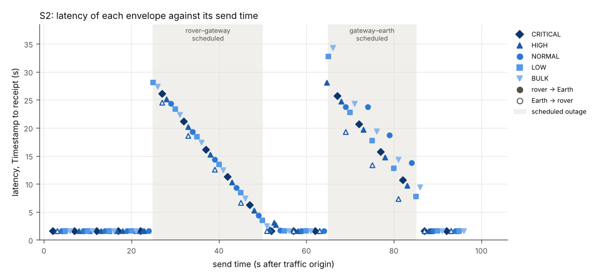
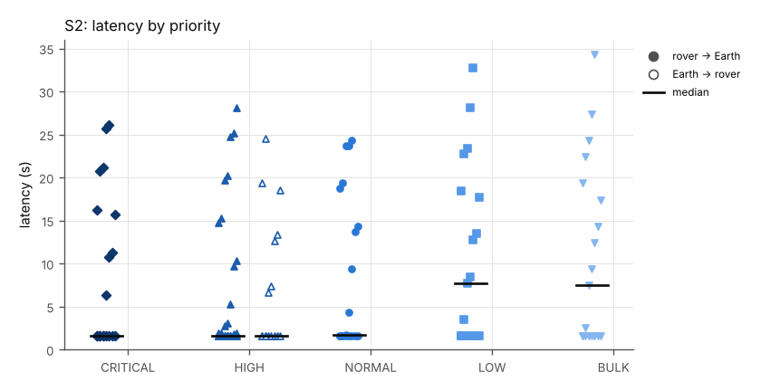

# PBS ION demo: results

Generated by `report/make_report.py` from `./` on 2026-10-07 06:04:08 UTC. Every number below is computed from the logs of these runs. The demo exercises the PBS-CONFORMANCE-01 and PBS-CONFORMANCE-02 items listed per scenario; it makes no conformance claim and no certification claim.

## Summary

| Scenario | Title | Result | Criteria | Received/sent envelopes | Median latency (s) | Max latency (s) | Clean ION stop |
|---|---|---|---|---|---|---|---|
| S2 | Scheduled outages in the contact plan: storage at rover, relay and Earth | PASS | 15/15 | 127/127 | 1.736 | 34.347 | yes |

Received/sent counts every envelope handed to ION, including those the scenario expects to be lost (S5) or rejected (S5, S6).

## Test environment

| Item | Value |
|---|---|
| Demo repository commit | 7095caaf1c12b92e3a382ed123b4b3d003b3b16c (tracked files modified) |
| ION | nasa-jpl/ION-DTN tag ion-open-source-4.2.0, commit 568df887cb9f18aa8ec013b1a566d83215e499ae; version string ION-OPEN-SOURCE-4.2.0; built by ion/build_ion.sh with NULL crypto suites (no BPSec) |
| Endpoint A (rover) | endpoint-python 0.1.0, PBS_LINK 0.1.4, Python 3.13.16; ION access through ctypes to libbp |
| Endpoint B (Earth) | endpoint-c 0.1.0, C, linked against ION libbp and OpenSSL libcrypto |
| Link emulator | emulator/linkemu.py (user-space UDP proxy, one socket per link direction, per-datagram log) |
| Host | Linux-6.18.44-fc-v77-x86_64-with-glibc2.39; 4 CPUs (Intel(R) Xeon(R) Processor @ 2.80GHz) |
| Clock | all three ION nodes, both endpoints and the emulator run on this host and read its CLOCK_REALTIME; kernel clock source tsc; NTP synchronized: not determined (timedatectl not available). No clock offset exists between the nodes; latency resolution is 1 us in the logs. |
| Cryptographic suites | PBS-SEC-B-01 demo suites 0xFF02 (Ed25519) and 0xFF01 (HMAC-SHA-256), TEST KEYS derived from public labels (docs/SPEC-DIGEST.md 6.3); not for operational use |
| Test vectors | docs/test-vectors.json, SHA-256 789ac1b4a02f38e8adf3d9bc1eeabe4d0bb7abc74a95b3dd8439633bcb3885ff |

Topology (`ion/topology.json`): ROVER node ipn:99 (Endpoint A on ipn:99.1, Source ID Rover-Alpha), LUNAR GATEWAY relay node ipn:50 (store and forward only, no PBS processing), EARTH node ipn:23 (Endpoint B on ipn:23.1, Source ID Earth-MCC). BPv7 over LTP over UDP; every LTP datagram between nodes passes through the emulator. One-way delays: rover-gateway 0.25 s; gateway-earth 1.3 s.

## S2: Scheduled outages in the contact plan: storage at rover, relay and Earth

Result: **PASS** (15 of 15 criteria passed).

Two planned outages that every node knows from the contact plan, each also enforced by the emulator: the rover-Gateway leg is down from 25 s to 50 s (rover out of view of the Gateway), and the Gateway-Earth leg is down from 65 s to 85 s (no Earth contact). The rover sends one telemetry envelope per second and answers PINGs; Mission Control sends a signed PING every 6 s. Envelopes are expected to wait in ION storage at the node in front of the closed leg and to be delivered after the contact resumes.

### Conditions

- Traffic phase: 105 s after the traffic origin; contact-plan reference time T0 = origin - 10 s (2026/10/07-06:01:43 UTC); traffic origin 2026-10-07 06:01:53 UTC.
- Endpoint A plan origin: -0.006 s from the traffic origin (bin/rover start-up 0.094 s); Endpoint B plan origin: the traffic origin (`--t0-us`).
- Legs: rover-gateway: one-way delay 0.25 s (emulator), contact-plan range 1 s, contact rate 125000 bytes/s; gateway-earth: one-way delay 1.3 s (emulator), contact-plan range 2 s, contact rate 125000 bytes/s.
- Emulator forwarding accuracy: 902 datagrams forwarded; send time minus scheduled time median 0.813 ms, p99 2.231 ms, max 4.694 ms.
- Emulator: delay only; no loss, no rate limit.
- Outage 25 s to 50 s on rover-gateway (scheduled): rover out of view of the Gateway (planned).
- Outage 65 s to 85 s on gateway-earth (scheduled): no Gateway-Earth contact (planned).
- Envelopes built (send records, including not sent): A->B: CRITICAL 19, HIGH 35, NORMAL 19, LOW 19, BULK 19; B->A: HIGH 16.

### Criteria

| ID | Criterion | Measured | Result |
|---|---|---|---|
| S2-1 | Every rover envelope handed to ION is received at Earth | 111 of 111 delivered (ratio 1.000) | PASS |
| S2-2 | Every Earth command handed to ION is received at the rover | 16 of 16 delivered (ratio 1.000) | PASS |
| S2-3 | Every received envelope is byte-identical to the envelope handed to ION | 127 of 127 received envelopes byte-identical (SHA-256 and header) | PASS |
| S2-4 | Every received envelope is accepted (no TTL expired in storage) | 127 of 127: ACCEPT OK | PASS |
| S2-5 | At 45 s the rover node holds rover envelopes sent since the rover-Gateway outage began | rover node held 20 matching bundles at 45.000 s (all bundles: 22) | PASS |
| S2-6 | At 45.5 s the Gateway node holds Earth commands waiting for the rover contact | gateway node held 3 matching bundles at 45.500 s (all bundles: 3) | PASS |
| S2-7 | At 80 s the Gateway node holds rover envelopes sent since 63 s, waiting for the Earth contact | gateway node held 17 matching bundles at 80.000 s (all bundles: 17) | PASS |
| S2-8 | At 80.5 s the Earth node holds commands waiting for the Gateway contact | earth node held 2 matching bundles at 80.500 s (all bundles: 3) | PASS |
| S2-9 | Rover envelopes sent during the rover-Gateway outage arrive no earlier than its end (50 s) plus 1.55 s propagation | 25 received; earliest receipt at 53.116 s | PASS |
| S2-10 | Earth commands sent during the rover-Gateway outage arrive no earlier than its end plus 0.25 s | 4 received; earliest receipt at 51.538 s | PASS |
| S2-11 | Rover envelopes sent during the Gateway-Earth outage arrive no earlier than its end (85 s) plus 1.3 s | 20 received; earliest receipt at 92.691 s | PASS |
| S2-12 | Earth commands sent during the Gateway-Earth outage arrive no earlier than its end plus 1.55 s | 3 received; earliest receipt at 88.348 s | PASS |
| S2-13 | No duplicate or unknown envelope is received | 127 recv records, 0 without a matching send record | PASS |
| S2-14 | No receiver accepts an envelope older than its TTL | 108 accepted envelopes with TTL > 0; 0 older than their TTL | PASS |
| S2-15 | No node transmits into a scheduled outage (emulator blackout drops = 0) | drop_blackout total 0 (rover-gateway=0, gateway-rover=0, gateway-earth=0, earth-gateway=0) | PASS |
| S2-16 | LTP segments from the Gateway discarded by Earth's LTP screening (informative) | earth node, span to gateway: in_seg_screened = 33 (ltpstats -a) | info |
| S2-17 | LTP segments from the rover discarded by the Gateway's LTP screening (informative) | gateway node, span to rover: in_seg_screened = 0 (ltpstats -a) | info |
| S2-18 | Checkpoints the Gateway resent to Earth (informative) | gateway node, span to earth: ckpt_re_xmit = 33 (ltpstats -a) | info |

### Measurements

Delivery and latency per direction and priority (latency = receive time minus envelope Timestamp, both from the host clock):

| Direction | Priority | Sent | Received | Delivery ratio | Min (s) | Median (s) | p95 (s) | Max (s) |
|---|---|---|---|---|---|---|---|---|
| A->B | CRITICAL | 19 | 19 | 1.000 | 1.574 | 1.585 | 25.697 | 26.122 |
| A->B | HIGH | 35 | 35 | 1.000 | 1.573 | 1.592 | 24.723 | 28.100 |
| A->B | NORMAL | 19 | 19 | 1.000 | 1.573 | 1.736 | 23.740 | 24.330 |
| A->B | LOW | 19 | 19 | 1.000 | 1.573 | 7.744 | 28.069 | 32.736 |
| A->B | BULK | 19 | 19 | 1.000 | 1.578 | 7.492 | 27.378 | 34.347 |
| B->A | HIGH | 16 | 16 | 1.000 | 1.573 | 1.588 | 19.347 | 24.537 |

Envelopes sent during an outage. Time held = latency minus the 1.55 s one-way propagation of the path. Leg resumed = first datagram the emulator received on either direction of the leg after the outage ended, minus the end time. Delivered after = receive time minus the end of the outage:

| Outage | Direction | Sent | Received | Time held min (s) | median (s) | max (s) | Leg resumed after (s) | Delivered after, first (s) | last (s) |
|---|---|---|---|---|---|---|---|---|---|
| rover-gateway 25-50 s (scheduled) | A->B | 25 | 25 | 1.944 | 13.678 | 25.828 | 1.250 | 3.116 | 3.489 |
| rover-gateway 25-50 s (scheduled) | B->A | 4 | 4 | 5.093 | 14.038 | 22.987 | 1.250 | 1.538 | 1.643 |
| gateway-earth 65-85 s (scheduled) | A->B | 20 | 20 | 6.194 | 17.503 | 32.797 | 1.345 | 7.691 | 15.342 |
| gateway-earth 65-85 s (scheduled) | B->A | 3 | 3 | 5.826 | 11.810 | 17.797 | 1.345 | 3.348 | 3.376 |

LTP blocks whose first checkpoint segment the emulator forwarded in the 3 s after the leg resumed; a block counts as resent when the sender transmitted its checkpoint again before any report segment for it came back; report delay = first report minus first checkpoint (emulator receive times):

| Outage | Data direction | Leg resumed after (s) | Blocks | Checkpoint resent before a report | Report delay min (s) | median (s) | max (s) |
|---|---|---|---|---|---|---|---|
| rover-gateway 25-50 s (scheduled) | rover-gateway | 1.250 | 35 | 0 | 0.253 | 0.267 | 0.322 |
| rover-gateway 25-50 s (scheduled) | gateway-rover | 1.250 | 5 | 0 | 0.252 | 0.265 | 0.269 |
| gateway-earth 65-85 s (scheduled) | gateway-earth | 1.345 | 30 | 23 | 1.302 | 6.328 | 11.328 |
| gateway-earth 65-85 s (scheduled) | earth-gateway | 1.345 | 4 | 0 | 1.302 | 1.304 | 1.308 |

Bundles held in ION storage (`bplist` on the node during the run; each bundle's payload identified as a demo envelope by Sequence and Timestamp):

| Probe | Node | At (s) | Bundles | Envelopes by label |
|---|---|---|---|---|
| rover during rover-Gateway outage | rover | 45.0 | 22 | S2-BULK x4; S2-CRITICAL x4; S2-HIGH x4; S2-LOW x5; S2-NORMAL x5 |
| Gateway during rover-Gateway outage | gateway | 45.5 | 3 | S2-PING x3 |
| Gateway during Gateway-Earth outage | gateway | 80.0 | 17 | PING-REPLY x1; S2-BULK x3; S2-CRITICAL x3; S2-HIGH x3; S2-LOW x3; S2-NORMAL x4 |
| Earth during Gateway-Earth outage | earth | 80.5 | 3 | S2-PING x3 |

Emulated links (counters from `emulator-stats.json`; LTP segment types decoded from each datagram; a data retransmission is a data segment whose session, offset and length the emulator had already seen on that link):

| Link | Delay (s) | Loss | Rate (B/s) | Queue (B) | Blackouts | Datagrams in | out | Lost (random) | Lost (blackout) | Lost (queue full) | LTP data segments | LTP reports | LTP cancels | LTP data retransmissions | Max queue wait (s) |
|---|---|---|---|---|---|---|---|---|---|---|---|---|---|---|---|
| earth-gateway | 1.3 | 0.0 | none | none | 65-85 scheduled | 151 | 151 | 0 | 0 | 0 | 17 | 118 | 0 | 1 | 0.0 |
| gateway-earth | 1.3 | 0.0 | none | none | 65-85 scheduled | 332 | 332 | 0 | 0 | 0 | 197 | 17 | 0 | 38 | 0.0 |
| gateway-rover | 0.25 | 0.0 | none | none | 25-50 scheduled | 143 | 143 | 0 | 0 | 0 | 16 | 111 | 0 | 0 | 0.0 |
| rover-gateway | 0.25 | 0.0 | none | none | 25-50 scheduled | 276 | 276 | 0 | 0 | 0 | 149 | 16 | 0 | 0 | 0.0 |

ION bundle counters per node (last `bpstats` report in the node's ion.log, cumulative since node start: sourced, forwarded, transmitted, received, delivered, reforwarded, deleted at lifetime expiry):

| Node | src | fwd | xmt | rcv | dlv | rfw | exp |
|---|---|---|---|---|---|---|---|
| rover | 111 | 111 | 111 | 16 | 16 | 0 | 0 |
| gateway | 0 | 127 | 127 | 127 | 0 | 0 | 0 |
| earth | 16 | 16 | 16 | 111 | 111 | 0 | 0 |

ION LTP span counters per node and span (`ltpstats -a` after the traffic phase; export = blocks this node sent on the span, import = blocks it received; screened = segments discarded because they arrived while the contact plan gave the sender no transmission to this node; backlog = red segments discarded because the blocks waiting for delivery to BP had reached the `m maxbacklog` limit, counted by ION as in_seg_too_fast):

| Node to peer | Checkpoints sent | Checkpoints resent | Data segments resent | Export cancels | Exports complete | Imports complete | Reports resent | Redundant segments in | Screened segments in | Backlog-discarded segments in |
|---|---|---|---|---|---|---|---|---|---|---|
| rover to gateway | 111 | 0 | 0 | 0 | 111 | 16 | 0 | 0 | 0 | 0 |
| gateway to earth | 116 | 33 | 15 | 0 | 111 | 16 | 1 | 1 | 0 | 0 |
| gateway to rover | 16 | 0 | 0 | 0 | 16 | 111 | 0 | 0 | 0 | 0 |
| earth to gateway | 16 | 1 | 0 | 0 | 16 | 111 | 2 | 5 | 33 | 5 |

### PBS conformance items exercised

| Item | How |
|---|---|
| PBS-CONFORMANCE-02 T011 | store-and-forward delivery across complete scheduled outages (S2-1, S2-2, S2-5 to S2-12) |
| PBS-CONFORMANCE-02 T002 | S2-3: headers unchanged after storage in ION |
| PBS-CONFORMANCE-01 4.2 | receive processing of stored-then-delivered envelopes (S2-4) |
| PBS-DTN-MAP-01 9; PBS-DTN-MAP-02 10 (store-and-forward delivery) | envelopes stored as bundles at the rover, the relay and Earth (S2-5 to S2-8) |
| PBS-CONFORMANCE-02 Section 4 (complete outage, delayed contact, service restoration) | two scheduled outages on different legs |

Files: `./S2/` (scenario definition `scenario.json`, contact plan `contacts.ionrc`, emulator configuration `emulator.json`, endpoint plans `rover-plan.json` and `earth-plan.jsonl`, endpoint logs `endpoint-a.jsonl` and `endpoint-b.jsonl`, emulator log `emulator.jsonl`, node logs `ion/`, tables `envelopes.csv`, `receipts.csv`, `links.csv`, `ionstats.csv`, verdict `verdict.json`).

## Not exercised

PBS-CONFORMANCE-02 T001 (IP carriage), T003 (provider or path transition), T005 (latest-state degradation), T009 (PNT context) and T013 (security layering with BPSec), and the PBS-DTN-MAP-02 Section 10 items on duplicate handling and on PBS-SEC-B preservation with BPSec enabled (docs/SPEC-DIGEST.md Section 9 and A35). ION is built without BPSec.

## Reproduce

`./run_demo.sh` from a clean checkout builds ION at the pinned commit into `build/`, builds both endpoints, runs S1 to S7, and rewrites `results/` and this file. `./run_demo.sh S4` runs one scenario. See README.md. Every run made of this demo, with its result, is listed in scenarios/README.md; every change to a pass/fail criterion made after a run is listed, with its reason, in docs/CRITERIA-CHANGES.md.
